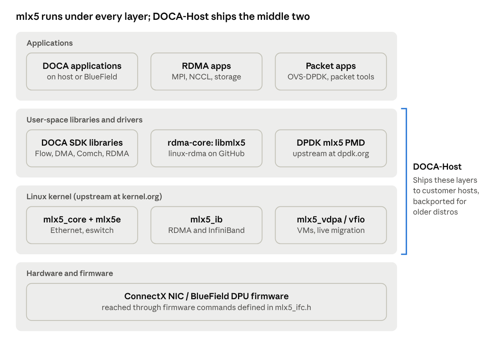
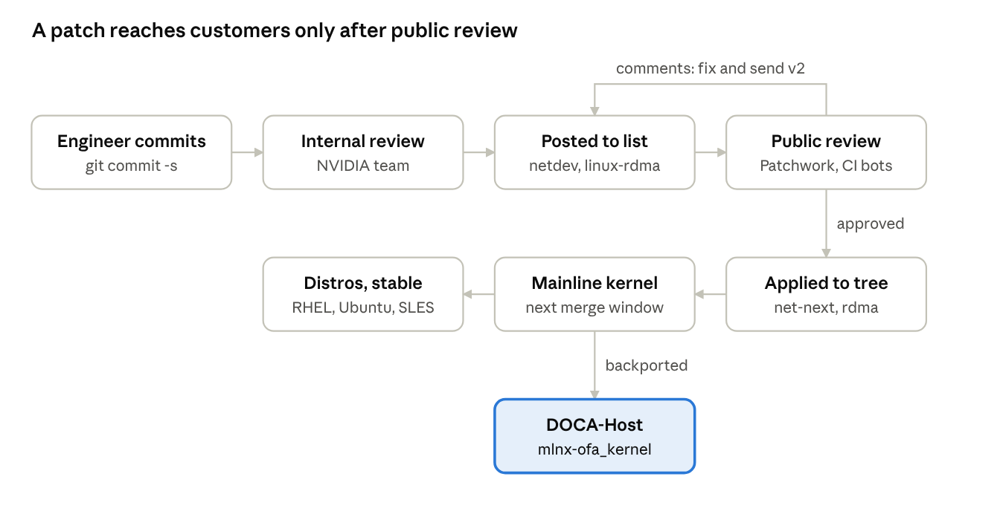

# NVIDIA Driver Manager Training: Linux, Git, mlx5, DOCA & DOCA-Host

Nov 3, 2026 · Itamar Katz

## How to use this training

In six weeks at about 5 hours a week, this course takes you from basic Git and Linux to understanding, building and following the work on mlx5, DOCA and DOCA-Host. You don't need to become a kernel developer. The goal is to read a patch, follow a review thread, know who decides what, and ask your engineers the right questions.

**Who it is for:** a new manager of the NVIDIA networking driver teams (mlx5 / DOCA / DOCA-Host) with general engineering knowledge and little Git or Linux kernel experience.

**By the end you will be able to:**

- Clone the kernel, rdma-core, DPDK and DOCA sources, and find the mlx5 code in each
- Use Git to see who changed what, when and why (`log`, `blame`, `show`, `bisect`)
- Explain how mlx5, DOCA-Host and DOCA fit together and where each one ships
- Follow a change from internal review to upstream merge, and ask for a change the right way
- Name the mailing lists, maintainers, trees and forums for each product, and know how to join them

| Week | Focus | Modules | Lab |
| --- | --- | --- | --- |
| 1 | Linux basics and a lab machine | 1 | Lab 1 |
| 2 | Git, hands-on | 2 | Lab 2 |
| 3 | The product map | 3 | Lab 3 |
| 4 | mlx5 upstream and the patch flow | 4 | Lab 4 |
| 5 | DOCA and DOCA-Host | 5 | Lab 5 |
| 6 | Communities and the manager playbook | 6, 7 | Lab 6 + quiz |

**Your lab machine:** you are on Windows. Install WSL2 with Ubuntu (`wsl --install -d Ubuntu` in an admin PowerShell) for Git and code reading. To load drivers and run traffic you need a real Linux server with a ConnectX NIC or BlueField DPU. Ask your team for access to a lab machine.

**Internal pieces to confirm with your team:** this training uses public sources only. Ask your leads where the internal repos, bug tracker, code review tool and CI live. Week 1 is a good time to ask (see Module 7).

## Module 1: Linux for a driver manager

A driver is code that runs inside the Linux kernel and talks to hardware. mlx5 is the kernel driver for every NVIDIA ConnectX NIC and BlueField DPU since ConnectX-4. This module covers just enough Linux to see a driver working on a real machine.

### 1.1 Key ideas

- **Kernel space and user space.** The kernel (with drivers like mlx5) manages the hardware. Applications and libraries (rdma-core, DPDK, DOCA libraries) run in user space and reach the hardware through the kernel or through direct, kernel-set-up paths.
- **Kernel module.** A driver built as a loadable file (`mlx5_core.ko`, `mlx5_ib.ko`) that you can load and unload while the system runs.
- **Distribution (distro).** RHEL, Ubuntu, SLES and others. Each ships its own kernel with its own copy of mlx5. That is why customers on old distros install DOCA-Host to get newer drivers.
- **Firmware.** Code that runs on the NIC itself. The driver and firmware must work together, so versions matter.

### 1.2 Commands to practise

| Command | What it shows |
| --- | --- |
| `uname -r` | Running kernel version |
| `cat /etc/os-release` | Distro and version |
| `lspci -nn \| grep -i mellanox` | NVIDIA (Mellanox) network devices on the PCI bus |
| `lsmod \| grep mlx5` | Whether the mlx5 modules are loaded |
| `modinfo mlx5_core` | Driver file, version, parameters |
| `sudo modprobe -r mlx5_ib mlx5_core` then `sudo modprobe mlx5_core` | Unload and reload the driver |
| `dmesg -T \| grep mlx5` | Kernel log lines from the driver (errors show up here first) |
| `ip link` / `ip addr` | Network interfaces and addresses |
| `ethtool -i <iface>` | Driver, driver version and firmware version for an interface |
| `ethtool -S <iface>` | Hardware and driver counters (drops, errors) |
| `devlink dev show` / `devlink dev info` | Device-level view: firmware versions, eswitch mode, health |
| `devlink health show` | Driver health reporters (mlx5 uses these heavily) |
| `rdma link` / `ibv_devinfo` | RDMA devices and port state |

### 1.3 Basic shell skills

- Move around: `pwd`, `ls -l`, `cd`, `less`, `grep -rn <text> <dir>`, `find . -name '*.c'`
- Packages: `apt` (Ubuntu) or `dnf` (RHEL). Install tools with `sudo apt install git build-essential ethtool rdma-core pciutils`
- Read the manual: `man ethtool`, `man git-log`

### 1.4 Read

- [The Linux Kernel documentation](https://docs.kernel.org/), especially the networking pages
- [mlx5 kernel documentation](https://docs.kernel.org/networking/device_drivers/ethernet/mellanox/mlx5/index.html), maintained by the mlx5 developers

## Module 2: Git, from zero to reading kernel history

Git records every change as a commit: who made it, when, why (the message) and exactly what changed (the diff). As a manager you will mostly *read* history. You will rarely write it. Linus Torvalds wrote Git for the Linux kernel, so kernel habits are Git habits.

### 2.1 Core concepts

- **Repository (repo):** a project folder plus its full history (the hidden `.git` folder).
- **Commit:** one saved change with an ID (SHA), author, date and message.
- **Branch:** a movable name pointing at a line of commits (`master`, `main`, `net-next`, `for-next`).
- **Remote:** a copy of the repo on a server (`origin` = where you cloned from). You can add more, e.g. `net-next`.
- **Clone / fetch / pull / push:** copy a repo / download new commits / download and merge / upload your commits.
- **Tag:** a fixed name for a commit, e.g. `v6.12` for a kernel release.
- **Working tree, staging area, commit:** you edit files, `git add` stages them, `git commit` saves them.

### 2.2 First-time setup

```bash
git config --global user.name "Your Name"
git config --global user.email "you@nvidia.com"
git config --global core.editor "nano"
git config --global pull.rebase true
```

### 2.3 Daily commands

| Goal | Command |
| --- | --- |
| Copy a repo | `git clone <url>` |
| What changed locally | `git status`, `git diff` |
| Save a change | `git add <file>` then `git commit -s` (`-s` adds the `Signed-off-by` line the kernel requires) |
| New branch | `git switch -c my-fix` |
| Update from server | `git fetch origin` then `git rebase origin/master` |
| History, one line each | `git log --oneline -20` |
| History of the mlx5 folder | `git log --oneline -- drivers/net/ethernet/mellanox/mlx5` |
| Commits by a person | `git log --author="Name" --oneline` |
| Commits between two releases | `git log --oneline v6.11..v6.12 -- drivers/net/ethernet/mellanox/mlx5` |
| Show one commit | `git show <sha>` |
| Who last changed each line | `git blame <file>` |
| Search commit messages | `git log --grep="mlx5e" --oneline` |
| Which release first had a commit | `git describe --contains <sha>` |
| Find the commit that broke something | `git bisect start`, `git bisect bad`, `git bisect good v6.10`, then test and mark until Git names the commit |

### 2.4 Kernel-style commits

A kernel commit message has a subsystem prefix, a short summary, a body explaining *why*, and tags:

```text
net/mlx5e: Fix crash when changing MTU during reset

Explain the problem, the cause and the fix in plain words.

Fixes: 1234567890ab ("net/mlx5e: Original commit title")
Signed-off-by: Developer Name <dev@nvidia.com>
Reviewed-by: Reviewer Name <rev@nvidia.com>
```

- `Signed-off-by` certifies the author has the right to submit the code (the Developer Certificate of Origin).
- `Reviewed-by`, `Acked-by`, `Tested-by` record who checked it. Count these when you look at your team's review culture.
- `Fixes:` links a bug fix to the commit that caused it. Stable kernels use it to pick up fixes.

### 2.5 Syncing with GitHub

- **Read only:** `git clone <url>` once, then `git pull` to get the latest changes.
- **Contribute through a fork:** fork the repo on GitHub, clone your fork, then add the original as `upstream`:

```bash
git remote add upstream https://github.com/linux-rdma/rdma-core.git
git fetch upstream
git rebase upstream/master
git push origin master --force-with-lease
```

- For a change: `git switch -c my-fix`, commit, `git push origin my-fix`, then open a Pull Request on GitHub.
- The kernel and DPDK mirrors on GitHub are read-only. Changes to those go by email (Module 4).

### 2.6 Learn more

- [Pro Git book](https://git-scm.com/book/en/v2), free. Read chapters 1 to 3 and 7.1 to 7.10
- [Learn Git Branching](https://learngitbranching.js.org/), an interactive visual tutorial (2 to 3 hours)
- [Kernel Git usage guide](https://docs.kernel.org/process/submitting-patches.html)

## Module 3: How mlx5, DOCA-Host and DOCA fit together

mlx5 is the driver, DOCA-Host is the package that ships it (and more) to customers' servers, and DOCA is the SDK and runtime that apps build on. The drivers are developed **upstream first**: code lands in the public Linux kernel, rdma-core and DPDK. NVIDIA then backports it into DOCA-Host for customers on older distros.



Each mlx5 piece is built in its upstream project first. DOCA-Host bundles the user-space and kernel layers for customers, and DOCA builds on top of them.

| Component | What it is | Where the source lives | Who uses it |
| --- | --- | --- | --- |
| mlx5 kernel driver | `mlx5_core` (Ethernet, eswitch, SR-IOV, devlink) and `mlx5_ib` (RDMA/InfiniBand), plus `mlx5_vdpa`, `mlx5_vfio_pci` | Upstream Linux kernel, `drivers/net/ethernet/mellanox/mlx5/` and `drivers/infiniband/hw/mlx5/` | Every Linux distro with a ConnectX NIC or BlueField |
| mlx5 user-space RDMA provider | `libmlx5` inside rdma-core (verbs, DevX, Direct Verbs) | [github.com/linux-rdma/rdma-core](https://github.com/linux-rdma/rdma-core), `providers/mlx5/` | RDMA apps, MPI, NCCL, storage |
| mlx5 DPDK driver (PMD) | Fast-path packet driver in user space | [DPDK](https://www.dpdk.org/), `drivers/net/mlx5/`, `drivers/common/mlx5/` | Packet processing, OVS-DPDK, DOCA Flow |
| DOCA-Host | Host software package for ConnectX / BlueField. It replaces the older `MLNX_OFED`. Profiles include `doca-ofed`, `doca-roce` and `doca-all` | Packages from NVIDIA. Its kernel part (`mlnx-ofa_kernel`) is a backport of upstream mlx5 | Customers who need newer drivers than their distro ships |
| DOCA SDK / runtime | Libraries, services and tools to program BlueField DPUs and SuperNICs (DOCA Flow, DMA, Comch, RDMA, telemetry and more) | NVIDIA, mostly internal. Documented at [docs.nvidia.com/doca](https://docs.nvidia.com/doca/sdk/index.html) | App developers on BlueField and host |
| Firmware and tools | NIC firmware, MFT (`mlxconfig`, `mlxfwmanager`, `mlxlink`), `mstflint` | Firmware is internal. `mstflint` is open on [GitHub](https://github.com/Mellanox/mstflint) | Support, operations |

**What this means for you as a manager**

- A feature usually touches several layers: firmware, then the kernel driver, then rdma-core or DPDK, then DOCA. Ask your team for the plan per layer and per release.
- Upstream release dates are not under NVIDIA's control. A feature that misses a kernel merge window waits about 9 to 10 weeks for the next one.
- "Upstream first" lowers long-term maintenance cost. A patch that lives only in DOCA-Host must be carried and rebased forever.

**Go deeper:** use cases, how an NVIDIA NIC and RDMA work, end-to-end configure/send/receive flows with the API at each layer, and a code-level deep dive are in [Module 3 deep dive](module3-deep-dive.md).

## Module 4: mlx5 upstream: clone, read, and ask for changes

In the Linux kernel you ask for a change by emailing a patch to the right maintainers and mailing list. There are no pull requests on GitHub. Reviewers reply by email, and a maintainer applies the patch to their tree. That tree flows to Linus Torvalds during the next merge window.

### 4.1 Clone the repositories

```bash
# Mainline Linux (large: use --depth for a quick start; drop it to get full history)
git clone https://git.kernel.org/pub/scm/linux/kernel/git/torvalds/linux.git

# Networking trees: net (fixes) and net-next (new features)
git clone https://git.kernel.org/pub/scm/linux/kernel/git/netdev/net-next.git
cd net-next
git remote add net https://git.kernel.org/pub/scm/linux/kernel/git/netdev/net.git
git remote add rdma https://git.kernel.org/pub/scm/linux/kernel/git/rdma/rdma.git
git remote add mellanox https://git.kernel.org/pub/scm/linux/kernel/git/mellanox/linux.git
git fetch --all

# User space
git clone https://github.com/linux-rdma/rdma-core.git
git clone https://github.com/DPDK/dpdk.git        # mirror of dpdk.org/git/dpdk
```

Tip: a full kernel clone is several GB. In WSL keep it inside the Linux file system (`~/src`), not under `/mnt/c`, or Git will be very slow.

### 4.2 Where mlx5 lives in the kernel

| Path | Contents |
| --- | --- |
| `drivers/net/ethernet/mellanox/mlx5/core/` | Core driver: firmware commands, health, devlink, SR-IOV, eswitch |
| `drivers/net/ethernet/mellanox/mlx5/core/en*` | `mlx5e`, the Ethernet netdev: TX/RX, XDP, TC offload, kTLS/IPsec |
| `drivers/net/ethernet/mellanox/mlx5/core/steering/` | Flow steering (software and hardware steering) |
| `drivers/infiniband/hw/mlx5/` | `mlx5_ib`, the RDMA driver |
| `include/linux/mlx5/` | Shared headers, including `mlx5_ifc.h` (the firmware interface) |
| `drivers/vdpa/mlx5/`, `drivers/vfio/pci/mlx5/` | vDPA and VFIO live migration support |
| `Documentation/networking/device_drivers/ethernet/mellanox/mlx5/` | Driver documentation |

Find the official owners with: `grep -n -A12 "MELLANOX MLX5" MAINTAINERS` and `./scripts/get_maintainer.pl -f drivers/net/ethernet/mellanox/mlx5/core/en_main.c`. The mlx5 maintainers listed there are NVIDIA engineers, so many of them are likely your own colleagues. Confirm the current names in the file.

**Go deeper:** how the driver comes to life, in two parts. Read them in order:

1. [PCIe deep dive](module4-pcie-probe-deep-dive.md): how Linux probes the PCIe host bridge, enumerates the buses, finds the ConnectX and calls `mlx5_core`'s `probe_one()`.
2. [mlx5 core objects deep dive](module4-mlx5-core-objects-deep-dive.md): `pdev`, `devlink`, `mlx5_core_dev` and the auxiliary devices that the Ethernet (`mlx5e`) and RDMA (`mlx5_ib`) drivers bind to.

### 4.3 The trees and how code flows

| Tree | Owner | Takes |
| --- | --- | --- |
| `netdev/net` | netdev maintainers | Bug fixes for the current release (subject `[PATCH net]`) |
| `netdev/net-next` | netdev maintainers | New Ethernet features (subject `[PATCH net-next]`). **Closed during the 2-week merge window** |
| `rdma/rdma` (`for-next`, `for-rc`) | RDMA maintainers | `mlx5_ib` and RDMA core changes |
| `mellanox/linux` (`mlx5-next`) | mlx5 maintainers | Shared mlx5 core changes needed by both net and rdma. Both trees pull it, so there are no conflicts |
| `torvalds/linux` | Linus Torvalds | Everything, at each merge window. A release every 9 to 10 weeks |
| `stable/linux` | Stable team | Backports of fixes tagged `Fixes:` / `Cc: stable` to long-term kernels |

### 4.4 How to ask for a change: the patch workflow



Review comments loop the patch back as v2 until a maintainer applies it. From mainline it reaches distros, and NVIDIA backports it into DOCA-Host.

1. **Raise it internally first.** Most mlx5 changes are written by NVIDIA engineers and reviewed internally before going public. Ask your team how internal review and "upstream submission" work today, and who sends series to the list. Often the mlx5 maintainers collect the team's patches and post them as a series.
2. **Prepare the patch.** Make a branch, commit with `git commit -s`, then check style with `./scripts/checkpatch.pl --strict -g HEAD`.
3. **Build and test.** `make allmodconfig`, then `make -j$(nproc) drivers/net/ethernet/mellanox/mlx5/` and functional tests on hardware.
4. **Generate patches.** `git format-patch -3 --cover-letter --subject-prefix="PATCH net-next" -o out/`
5. **Find recipients.** `./scripts/get_maintainer.pl out/*.patch`
6. **Send.** `git send-email --to=netdev@vger.kernel.org --cc=<maintainers> out/*.patch`. Many developers use [b4](https://b4.docs.kernel.org/) to prepare and send.
7. **Track it.** The patch shows up on [lore.kernel.org/netdev](https://lore.kernel.org/netdev/) and in [Patchwork](https://patchwork.kernel.org/project/netdevbpf/list/), where automated build bots (NIPA) run checks. RDMA uses [its own Patchwork](https://patchwork.kernel.org/project/linux-rdma/list/).
8. **Respond to review.** Fix the comments and resend as `v2` with a changelog under the `---` line. For netdev, wait at least 24 hours between versions.
9. **Merged.** A maintainer replies "applied" with the commit ID.

Rules worth knowing (from [maintainer-netdev](https://docs.kernel.org/process/maintainer-netdev.html)): at most 15 patches per series, plain-text email only, no top-posting, reply inline.

### 4.5 Other ways to ask for a change

- **Report a bug upstream:** email netdev or linux-rdma with the kernel version, `dmesg` and steps to reproduce, and Cc the maintainers.
- **rdma-core:** open an issue or pull request on [GitHub](https://github.com/linux-rdma/rdma-core/pulls). This one does use GitHub PRs.
- **DPDK mlx5:** email patches to `dev@dpdk.org` and track them in [DPDK Patchwork](https://patches.dpdk.org/). Report bugs in [DPDK Bugzilla](https://bugs.dpdk.org/). mlx5 PMD patches go through the `next-net-mlx` sub-tree.
- **Customers:** through NVIDIA Enterprise Support, which turns into an internal ticket for your team.

### 4.6 Read a review thread (manager skill)

Open [lore.kernel.org/netdev](https://lore.kernel.org/netdev/) and search `s:mlx5` (subject contains mlx5). Pick a recent series and read: the cover letter, the reviewers' questions, the v2 changelog, and the final "applied" mail. Do this weekly for 15 minutes. You will quickly learn who the key reviewers are and how your team's work is received.

## Module 5: DOCA and DOCA-Host

DOCA is NVIDIA's own product, so most of its development happens in internal repos, not in public. Changes are requested through internal tickets and code review. Your public touchpoints are the documentation, the developer forum, the release notes and the open-source parts it builds on.

### 5.1 DOCA-Host

- **What it is:** the single host package for ConnectX and BlueField. It brings the drivers (`mlnx-ofa_kernel`, backported mlx5), rdma-core, the DPDK mlx5 driver, firmware tools and the DOCA runtime. It replaces `MLNX_OFED`, which was the older driver bundle.
- **Profiles:** you install only what you need, for example `doca-ofed` (the classic OFED set), `doca-roce`, `doca-networking` or `doca-all`. Check the current list in the installation guide for your release.
- **Install (lab practice):** follow the [DOCA installation guide](https://docs.nvidia.com/doca/sdk/doca-host-installation-and-upgrade/index.html). In short: add the NVIDIA DOCA package repo for your distro, install the profile (for example `sudo apt install doca-ofed`), then restart the driver (`sudo /etc/init.d/openibd restart`) or reboot.
- **Check what is installed:** `ofed_info -s`, `dpkg -l | grep doca` (Ubuntu) or `rpm -qa | grep doca` (RHEL), and `modinfo mlx5_core | grep -i version`.
- **The manager's key question:** for each release, which upstream kernel version is the backport based on, and which fixes and features are "DOCA-Host only" (not yet upstream)?

### 5.2 DOCA SDK

- **What it is:** libraries and services to program BlueField DPUs, SuperNICs and the host, such as DOCA Flow (packet steering), DMA, Comch (host and DPU messaging), RDMA, GPUNetIO and telemetry. On BlueField it ships in the BFB image, the DPU's operating system bundle.
- **Source:** internal. Public samples and some apps ship with the SDK, typically under `/opt/mellanox/doca/samples` and `/opt/mellanox/doca/applications` after install. Some projects are on NVIDIA's public GitHub ([github.com/NVIDIA](https://github.com/NVIDIA) and [github.com/Mellanox](https://github.com/Mellanox)). Search there for "doca".
- **Build a sample (lab):** `cd /opt/mellanox/doca/samples/doca_flow/flow_drop` then `meson setup /tmp/build && ninja -C /tmp/build`.
- **Docs:** [DOCA SDK documentation](https://docs.nvidia.com/doca/sdk/index.html). Read the overview, the release notes for the latest version, and the DOCA-Host and BlueField sections.

### 5.3 How to ask for changes in DOCA and DOCA-Host

| Who is asking | Channel |
| --- | --- |
| You or your team | Internal bug tracker and code review. Ask your leads which tools and projects (and how tickets are triaged) |
| Another NVIDIA team | Internal ticket to your team's component, plus a sync with the product manager |
| A customer | NVIDIA Enterprise Support case, escalated to engineering as an internal ticket |
| A developer in the community | [NVIDIA Developer Forum, DOCA category](https://forums.developer.nvidia.com/c/infrastructure/doca/) |
| A change in an upstream part (mlx5, rdma-core, DPDK) | The upstream flow in Module 4, then backport into DOCA-Host |

## Module 6: Find and connect with the communities

Each product has a different community. The upstream kernel works by email, rdma-core by GitHub, DPDK by email, and DOCA through NVIDIA's own forum and support channels. You join a community by reading it first, then helping. Being present in the community gives your team influence when decisions are made.

### 6.1 The community map

| Product area | Main channel | Archive / tracker | How to join |
| --- | --- | --- | --- |
| mlx5 Ethernet (`mlx5e`, core) | `netdev@vger.kernel.org` | [lore.kernel.org/netdev](https://lore.kernel.org/netdev/), [Patchwork netdevbpf](https://patchwork.kernel.org/project/netdevbpf/list/) | Read on lore, no sign-up needed. To subscribe, see [subspace.kernel.org](https://subspace.kernel.org/vger.kernel.org.html) |
| mlx5 RDMA (`mlx5_ib`) | `linux-rdma@vger.kernel.org` | [lore.kernel.org/linux-rdma](https://lore.kernel.org/linux-rdma/), [Patchwork linux-rdma](https://patchwork.kernel.org/project/linux-rdma/list/) | Same as netdev |
| rdma-core (`libmlx5`) | GitHub | [linux-rdma/rdma-core](https://github.com/linux-rdma/rdma-core) issues and PRs | Watch the repo on GitHub |
| DPDK mlx5 PMD | `dev@dpdk.org`, `users@dpdk.org` | [mails.dpdk.org](https://mails.dpdk.org/listinfo), [patches.dpdk.org](https://patches.dpdk.org/), [bugs.dpdk.org](https://bugs.dpdk.org/) | Subscribe to the lists; join the [DPDK Slack](https://www.dpdk.org/) |
| DOCA / DOCA-Host | NVIDIA Developer Forum | [DOCA forum](https://forums.developer.nvidia.com/c/infrastructure/doca/), [DOCA docs](https://docs.nvidia.com/doca/sdk/index.html) | Register with an NVIDIA developer account |
| Wider networking community | Conferences | [Netdev Conf](https://netdevconf.info/), [Linux Plumbers Conference](https://lpc.events/), [DPDK Summit](https://www.dpdk.org/), [OpenFabrics Alliance](https://www.openfabrics.org/) workshops, NVIDIA GTC | Attend; encourage your engineers to give talks |

### 6.2 Identify the people

- **Maintainers:** `MAINTAINERS` in the kernel and DPDK repos lists the owner of each area. Run `get_maintainer.pl` on a file to get names and lists.
- **Most active contributors:** `git shortlog -sne --since="1 year ago" -- drivers/net/ethernet/mellanox/mlx5 | head -20`
- **Most active reviewers:** `git log --since="1 year ago" -- drivers/net/ethernet/mellanox/mlx5 | grep -E "Reviewed-by|Acked-by" | sort | uniq -c | sort -rn | head`
- **Upstream decision makers:** the netdev maintainers (who apply to net and net-next), the RDMA maintainers, and the DPDK tree maintainers. Names change, so always check `MAINTAINERS`.
- **Partners and customers:** the other big names in these threads (cloud providers, distros such as Red Hat, SUSE and Canonical, and other NIC vendors). These are the companies whose engineers review and test your team's code.

### 6.3 Connect with them

1. **Start inside NVIDIA.** Meet the engineers on your team who are upstream maintainers or regular contributors. Ask them for the 5 to 10 external people who matter most.
2. **Read before you write.** Follow lore and Patchwork for 2 to 3 weeks to learn the tone and the people.
3. **Write plain-text email.** Reply inline, no HTML, no top-posting, short and technical.
4. **Give before you ask.** Your team reviewing other people's patches (`Reviewed-by`) builds goodwill faster than anything else.
5. **Meet in person.** Netdev Conf, Plumbers and the DPDK Summit are where relationships form. Budget for them.
6. **Distro partners:** set up regular syncs with Red Hat, SUSE and Canonical kernel teams about which mlx5 fixes they need backported.

## Module 7: The manager playbook

Your job is to make upstream timing, internal releases and customer needs line up. Spend your first 30 days learning the release calendar, the people and the process. Don't try to change any of them yet.

### 7.1 Two calendars to track

- **Upstream:** a kernel release every 9 to 10 weeks. Each one has a 2-week merge window (net-next is closed), then about 7 to 8 weekly release candidates (`-rc1` … `-rc7`). Features must be in net-next or rdma for-next *before* the merge window opens. Check [kernel.org](https://www.kernel.org/) for the current version and [the netdev status page](https://patchwork.hopto.org/net-next.html) for whether net-next is open. DPDK releases 4 times a year (`YY.03`, `.07`, `.11` and an LTS each November).
- **NVIDIA internal:** DOCA / DOCA-Host release dates, the LTS branches, code freeze dates and firmware alignment. Get this calendar from your program manager in week 1.

### 7.2 Questions to ask your team in the first month

- [ ] Where are the internal repos, and what is the branching model (main, release, LTS branches)?
- [ ] What is the code review tool and the rule (how many reviewers, who can merge)?
- [ ] How does a change go from internal review to upstream submission? Who posts series to netdev and linux-rdma?
- [ ] How do upstream changes get backported into DOCA-Host, and how far behind upstream are we?
- [ ] How many patches do we carry only in DOCA-Host (not upstream)? What is the plan to reduce them?
- [ ] Which CI and regression tests run per commit and per release? On which hardware?
- [ ] What is the bug tracker, and what are the open P1/P2 bugs and customer escalations?
- [ ] Who on the team is a maintainer or a regular upstream reviewer?
- [ ] Which features are in flight for the next upstream merge window and the next DOCA release?

### 7.3 Useful health metrics

| Metric | How to get it | Why it matters |
| --- | --- | --- |
| Patches merged upstream per release | `git log --oneline v6.X..v6.Y -- <mlx5 paths> \| wc -l` | Upstream throughput |
| Patches waiting for review | Patchwork, filter by delegate or submitter | Bottlenecks in review |
| Time from first post to merge | lore thread dates (v1 to "applied") | Review friction |
| Out-of-tree patch count in DOCA-Host | Ask the backport owner | Long-term maintenance cost |
| `Fixes:` commits against your code | `git log --grep="Fixes:" -- <paths>` | Quality trend |
| Escalations and open customer bugs | Internal tracker | Customer impact |

### 7.4 Good habits

- Protect time for upstream review work. It is real work, even when it is not in a sprint plan.
- Plan features for a merge window, with a buffer for one or two rounds of review.
- Never promise a customer an upstream date. Promise the DOCA-Host release, and say upstream merge is "targeted".
- Celebrate merged upstream series in public. It motivates the team and shows the value.

## Hands-on labs and self-check

Do each lab in its week. Tick each item as you finish it.

### Lab 1: Linux (week 1)

- [ ] Install WSL2 Ubuntu and run `uname -r`, `cat /etc/os-release`
- [ ] On a lab server with a ConnectX NIC: run `lspci`, `lsmod`, `modinfo mlx5_core`, `ethtool -i`, `devlink dev info`, and write down the firmware and driver versions
- [ ] Reload the driver with `modprobe` and read the `dmesg` lines it prints

### Lab 2: Git (week 2)

- [ ] Finish the "Main" levels of [Learn Git Branching](https://learngitbranching.js.org/)
- [ ] Create a local repo, make 3 commits on a branch, rebase it on main, and look at `git log --graph --oneline`
- [ ] Clone rdma-core (it is small) and use `git log`, `git show` and `git blame` on `providers/mlx5/mlx5.c`

### Lab 3: Product map (week 3)

- [ ] Draw your own version of the Module 3 diagram from memory, then compare
- [ ] Ask a senior engineer to walk you through one recent feature across firmware, kernel, user space and DOCA

### Lab 4: mlx5 upstream (week 4)

- [ ] Clone net-next. List the mlx5 commits in the last kernel release with `git log --oneline v6.X..v6.Y -- drivers/net/ethernet/mellanox/mlx5`
- [ ] Run `get_maintainer.pl` on an mlx5 file and note the names and lists
- [ ] Read one mlx5 series on lore from v1 to "applied"
- [ ] Build the mlx5 driver in WSL: `make defconfig`, enable `CONFIG_MLX5_CORE` and `CONFIG_MLX5_CORE_EN` with `make menuconfig`, then `make -j$(nproc) drivers/net/ethernet/mellanox/mlx5/`
- [ ] Make a tiny comment-only change, commit with `-s`, run `checkpatch.pl` and `git format-patch`. **Do not send it.**

### Lab 5: DOCA-Host and DOCA (week 5)

- [ ] Install a DOCA-Host profile on a lab server and check the versions with `ofed_info -s`
- [ ] Build and run one DOCA sample
- [ ] Read the latest DOCA release notes and list 3 features owned by your team

### Lab 6: Community (week 6)

- [ ] Subscribe to netdev and linux-rdma in a mail filter, or bookmark lore searches for `s:mlx5`
- [ ] Run the `git shortlog` and reviewer commands from Module 6, and list the top 10 contributors and reviewers
- [ ] Join the DOCA forum and read the 10 most recent threads
- [ ] Meet two team members who work upstream and write down their advice

### Self-check quiz

1. Which kernel modules make up mlx5 and what does each do?
2. What is the difference between `net` and `net-next`, and when is net-next closed?
3. What does `Signed-off-by` mean, and what does `Fixes:` do?
4. Why does NVIDIA push mlx5 changes upstream first instead of only into DOCA-Host?
5. How would a customer, an NVIDIA colleague, and an outside developer each ask for a change in DOCA?
6. Which command shows who last changed a line of code? Which one finds the commit that caused a bug?
7. Where do you check whether an mlx5 patch was reviewed and applied?
8. Name the mailing list for mlx5 RDMA changes and the one for DPDK mlx5 changes.

Answers are in Modules 2 to 6. Go over any you miss with a senior engineer.

## Cheat sheet and glossary

### Cheat sheet

```bash
# Clone
git clone https://git.kernel.org/pub/scm/linux/kernel/git/netdev/net-next.git
git clone https://github.com/linux-rdma/rdma-core.git

# Read history
git log --oneline -- drivers/net/ethernet/mellanox/mlx5
git show <sha>
git blame <file>
git describe --contains <sha>
git shortlog -sne --since="1 year ago" -- <path>

# Make and send a patch
git switch -c my-fix
git commit -s
./scripts/checkpatch.pl --strict -g HEAD
git format-patch -1 --subject-prefix="PATCH net-next"
./scripts/get_maintainer.pl 0001-*.patch
git send-email --to=netdev@vger.kernel.org 0001-*.patch

# Inspect the driver on a machine
lspci -nn | grep -i mellanox
ethtool -i <iface>
devlink dev info
dmesg -T | grep mlx5
ofed_info -s
```

### Glossary

| Term | Meaning |
| --- | --- |
| BFB | BlueField boot image: the OS and software bundle for a DPU |
| BlueField | NVIDIA's DPU: a NIC with Arm cores that runs its own Linux |
| ConnectX | NVIDIA's NIC family, driven by mlx5 |
| DCO | Developer Certificate of Origin, agreed to by `Signed-off-by` |
| DevX | mlx5 interface that lets user space send firmware commands directly |
| DPDK | Data Plane Development Kit, user-space packet processing |
| eswitch / switchdev | The embedded switch in the NIC, used for SR-IOV and OVS offload |
| LTS | Long-term support release |
| lore | lore.kernel.org, the archive of all kernel mailing lists |
| Merge window | The 2 weeks after a kernel release when new features enter mainline |
| MLNX_OFED | The older NVIDIA driver bundle, replaced by DOCA-Host |
| Patchwork | Web tracker of patches posted to a mailing list |
| PMD | Poll Mode Driver, a DPDK driver |
| RDMA / RoCE | Remote Direct Memory Access / RDMA over Converged Ethernet |
| SR-IOV / VF | Splitting one NIC into many virtual functions for VMs |
| Upstream | The public project (kernel, rdma-core, DPDK) that NVIDIA contributes to |
| Verbs | The standard RDMA programming API (`libibverbs`) |
