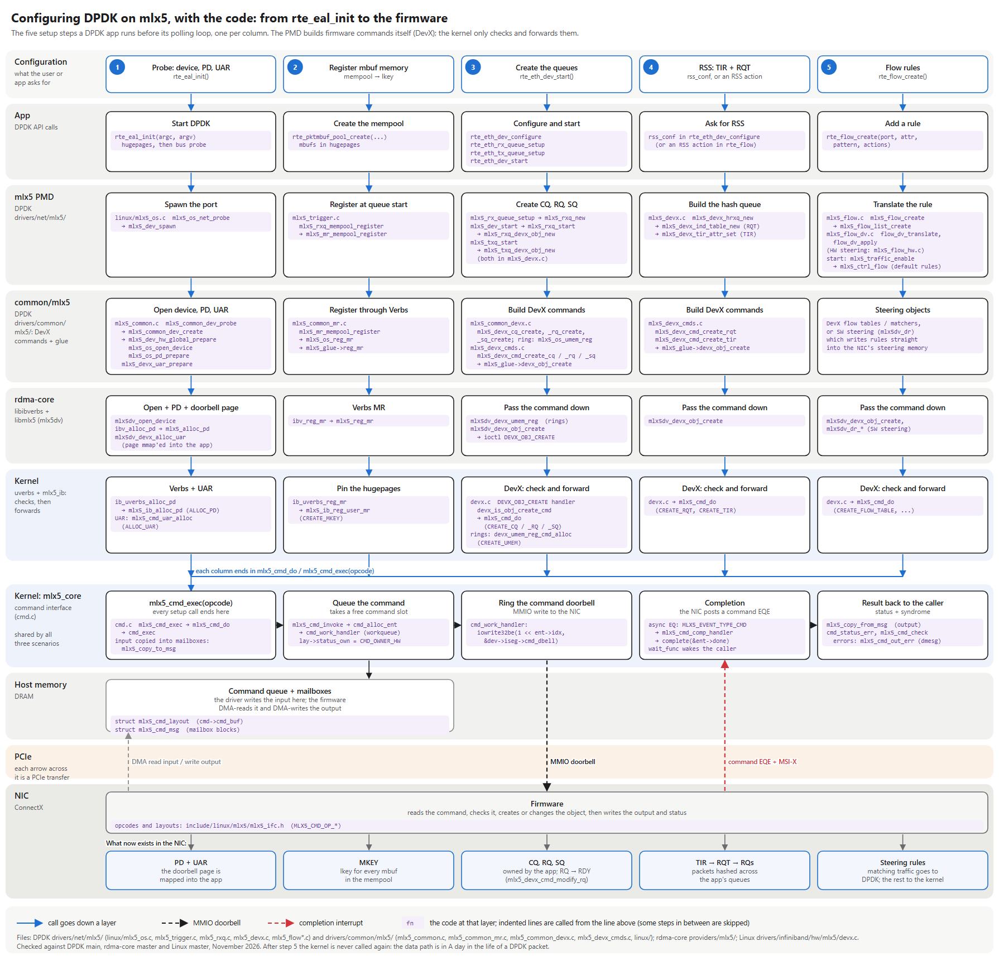

# Configuring DPDK on mlx5: from `rte_eal_init` to the firmware

Part of [Configuration flows](config-flows.md). It's the setup half of [A day in the life of a DPDK packet](packet-dpdk.md).

This drawing shows the five setup steps a DPDK app runs before its polling loop, one per column. Each column goes down through the layers: the app, the mlx5 PMD, DPDK's shared mlx5 code (`common/mlx5`), rdma-core, and the kernel. It ends as a firmware command. The bottom part, how a firmware command travels, is shared by all three configuration drawings and is explained on [the overview page](config-flows.md#the-shared-part-how-one-firmware-command-travels).

**How to read it**

- **Columns** are the five setup steps, numbered 1 to 5.
- **Rows** are layers, from the app at the top to the firmware at the bottom.
- The **purple block** in each box is the code that does that layer's work. Indented lines are called from the line above.
- The **blue boxes at the bottom** show what exists in the NIC after the column finishes.

*Click the image to open it full size.*

---

## What is special about DPDK setup: DevX

In the kernel path (`mlx5e`) and the RDMA path (`mlx5_ib`), the **kernel** decides what the firmware command looks like. In DPDK, the **PMD builds the firmware command itself**, byte for byte, in `drivers/common/mlx5/mlx5_devx_cmds.c`. It hands the command to rdma-core (`mlx5dv_devx_obj_create`), which passes it through an `ioctl` to the kernel. The kernel's `devx.c` only **checks** that the command is allowed for this app, then sends it on with `mlx5_cmd_do`.

This is called **DevX**. It lets DPDK use new firmware features without waiting for new kernel code. In exchange, a DPDK bug can send a wrong command, so "firmware rejected a DevX command" is a common DPDK support question.

---

## The five columns in plain words

| # | Step | What happens | Firmware command |
| --- | --- | --- | --- |
| **1** | Probe: device, PD, UAR | `rte_eal_init` reserves hugepages and probes the PCI device. DPDK's mlx5 code opens the device through rdma-core, allocates a **PD**, and allocates a **UAR**: the NIC's doorbell page, which is then **mapped into the app**. That is how the app will ring doorbells later without a system call | `ALLOC_PD`, `ALLOC_UAR` |
| **2** | Register mbuf memory | The mempool's hugepage memory is registered with the NIC through the normal verbs call `ibv_reg_mr`. The kernel pins the pages and the firmware returns an **lkey**, which the PMD puts in every RX and TX descriptor | `CREATE_MKEY` |
| **3** | Create the queues | At `rte_eth_dev_start`, the PMD allocates each ring in hugepages and registers it as a **umem**. It then builds the DevX commands to create the CQ, RQ and SQ, and moves them to the ready state | `CREATE_UMEM`, `CREATE_CQ`, `CREATE_RQ`, `CREATE_SQ`, `MODIFY_RQ`, `MODIFY_SQ` |
| **4** | RSS: TIR + RQT | For RSS, the PMD creates an **RQT** (the list of the app's RQs) and a **TIR** (the hash function and key that pick an RQ from that list) | `CREATE_RQT`, `CREATE_TIR` |
| **5** | Flow rules | `rte_flow_create` (and, at start, the default rules from `mlx5_traffic_enable`) is translated by the PMD into steering objects. Some go through DevX commands. With software steering (`mlx5dv_dr`), rules are written straight into the NIC's steering memory | `CREATE_FLOW_TABLE` and related commands |

**After step 5** the kernel is never called again. Every packet is handled in user space, as shown in [A day in the life of a DPDK packet](packet-dpdk.md).

---

## Watch it on a real machine

| What to see | Command |
| --- | --- |
| Run the setup steps | `dpdk-testpmd -a <pci-address> -- -i` |
| The PMD's own setup messages | Add `--log-level=pmd.net.mlx5:debug` to the EAL arguments |
| The DevX firmware commands as they pass the kernel | Enable the `mlx5:mlx5_cmd` tracepoint (see [the overview](config-flows.md#watch-configuration-on-a-real-machine)), then start testpmd |
| The flow rules DPDK installed | In testpmd: `flow list 0` |

Files: DPDK `drivers/net/mlx5/` (`linux/mlx5_os.c`, `mlx5_trigger.c`, `mlx5_rxq.c`, `mlx5_devx.c`, `mlx5_flow*.c`) and `drivers/common/mlx5/` (`mlx5_common.c`, `mlx5_common_mr.c`, `mlx5_common_devx.c`, `mlx5_devx_cmds.c`, `linux/`); rdma-core `providers/mlx5/`; Linux `drivers/infiniband/hw/mlx5/devx.c`. The names were checked against DPDK `main`, rdma-core `master` and Linux `master` in November 2026.

Editable source of the drawing: [images/config-dpdk.svg](images/config-dpdk.svg).
