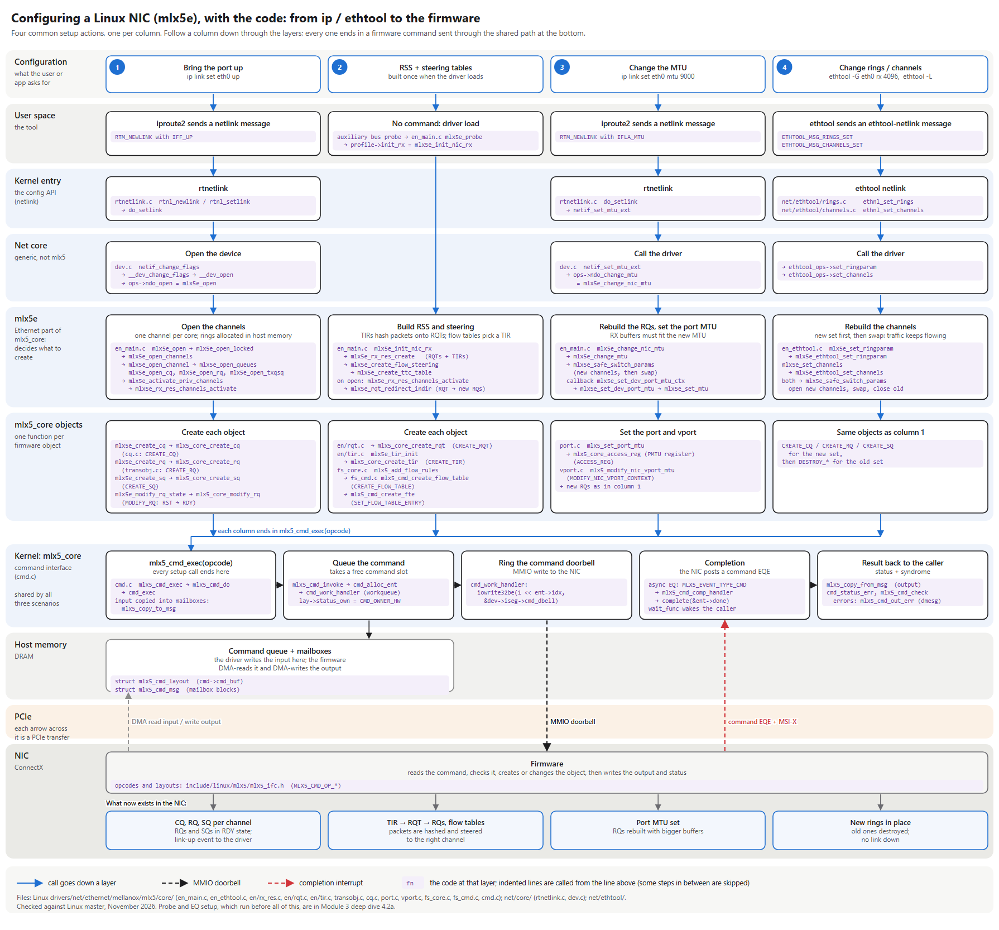
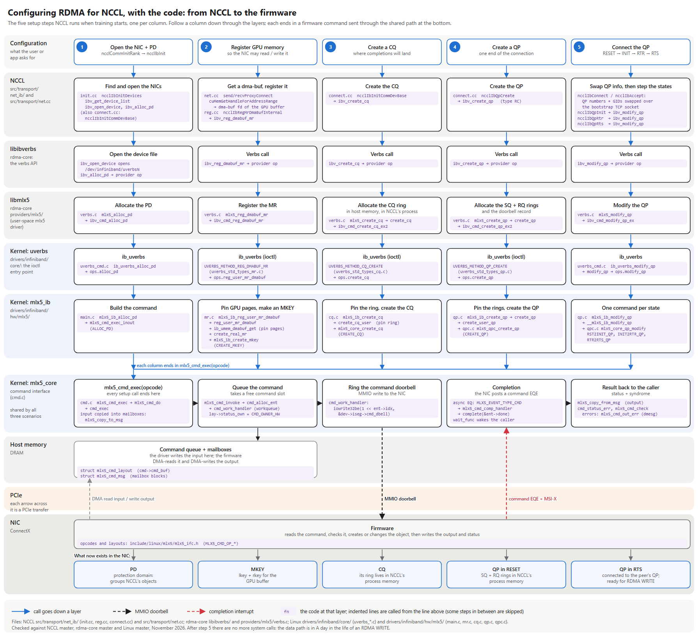
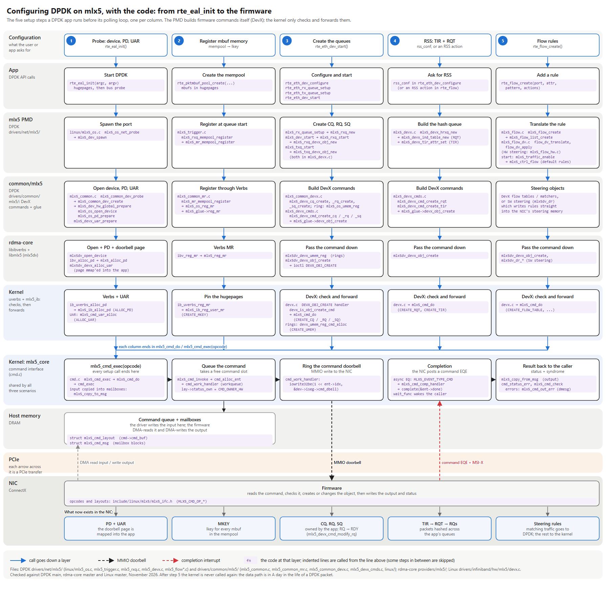

# Configuration flows: how setup reaches the NIC

The "day in the life" pages ([kernel](packet-life.md), [DPDK](packet-dpdk.md), [RDMA/NCCL](packet-rdma-nccl.md)) follow **packets**. That's the fast path, which runs millions of times a second with no firmware involved.

This page is about the other half: **configuration**, the slow path. Before any packet can flow, something must create the queues, register memory, set up steering, and connect QPs. Every one of those actions ends as a **firmware command**, and every firmware command goes through the same small piece of `mlx5_core`.

Below: the shared command path first, then one drawing per scenario. **Click a drawing to open its page.**

---

## The idea in one picture

| | Fast path (packets) | Slow path (configuration) |
| --- | --- | --- |
| What | Send and receive data | Create, change and destroy objects: CQ, RQ, SQ, QP, MKEY, TIR, flow tables, MTU |
| How | WQEs in rings + doorbells, no firmware | **Firmware commands**, one per action |
| Who sends it | The driver, or the app itself (DPDK, RDMA) | Always the kernel's `mlx5_core`, even when the request starts in an app |
| How often | Millions per second | Rarely: at start, on changes, at teardown |
| Where it goes wrong | Drops, retransmits, latency | A command fails: wrong parameters, missing capability, out of resources. The firmware returns a **status** and a **syndrome** |

---

## The shared part: how one firmware command travels

All three drawings end in the same band at the bottom. It works like this:

| Step | What happens | Code (`drivers/net/ethernet/mellanox/mlx5/core/cmd.c`) |
| --- | --- | --- |
| 1 | The caller fills in the command's input (layouts are in `include/linux/mlx5/mlx5_ifc.h`) and calls the command function | `mlx5_cmd_exec` → `mlx5_cmd_do` → `cmd_exec` |
| 2 | The input is copied into **mailboxes** in host memory | `mlx5_copy_to_msg` |
| 3 | The driver takes a free command slot, writes the command entry, and hands ownership to the hardware | `mlx5_cmd_invoke` → `cmd_alloc_ent` → `cmd_work_handler` sets `CMD_OWNER_HW` |
| 4 | It rings the **command doorbell**: an MMIO write to the NIC's initialization segment | `iowrite32be(1 << ent->idx, &dev->iseg->cmd_dbell)` |
| 5 | The **firmware** DMA-reads the command, checks it, does the work (creates the CQ, moves the QP to RTS, ...), and DMA-writes the output and status back | firmware, not in the kernel tree |
| 6 | The NIC posts a **command-completion event** on the async event queue and raises an interrupt | EQE type `MLX5_EVENT_TYPE_CMD` → `mlx5_cmd_comp_handler` |
| 7 | The waiting caller wakes up and copies the output back. A non-zero status is turned into an errno, and the syndrome is printed in `dmesg` | `wait_func`, `mlx5_copy_from_msg`, `cmd_status_err`, `mlx5_cmd_out_err` |

**Why it matters to you:** a "firmware command failed" bug report always shows an **opcode**, a **status** and a **syndrome**. The opcode tells you which column of the drawings you're in. The syndrome is the firmware's exact reason, and the firmware team can decode it.

---

## Scenario 1: Linux NIC (kernel networking)

How `ip` and `ethtool` reach the firmware through netlink, the net core, `mlx5e` and `mlx5_core`. Four actions: bring the port up, build RSS and steering, change the MTU, change rings and channels.

**[Open the Linux NIC configuration page](config-linux-nic.md)**

---

## Scenario 2: NCCL / RDMA

How NCCL sets up RDMA when training starts: open the NIC and allocate a PD, register GPU memory, create a CQ, create a QP, connect it. The path goes through libibverbs, `libmlx5`, the kernel's uverbs `ioctl` and `mlx5_ib`.

**[Open the NCCL / RDMA configuration page](config-rdma-nccl.md)**

---

## Scenario 3: DPDK

How a DPDK app sets up the NIC before its polling loop: probe the device, register mbuf memory, create the queues, set up RSS, add flow rules. The PMD builds the firmware commands itself (**DevX**) and the kernel only checks and forwards them.

**[Open the DPDK configuration page](config-dpdk.md)**

---

## The three side by side

| | Linux NIC | NCCL / RDMA | DPDK |
| --- | --- | --- | --- |
| Who asks | An admin tool (`ip`, `ethtool`) or the driver itself | NCCL, through the verbs API | The DPDK app, through `rte_eth_*` and `rte_flow_*` |
| Way into the kernel | netlink | `ioctl` on `/dev/infiniband/uverbsN` | `ioctl` on the same device file (DevX methods) |
| Who builds the firmware command | `mlx5e` / `mlx5_core` | `mlx5_ib` | **The DPDK PMD itself** (DevX). The kernel only checks it is allowed |
| Where the rings live | Kernel memory | NCCL's process memory | DPDK's hugepages |
| Kernel after setup | On every packet | Never | Never |

---

## Watch configuration on a real machine

| What to see | Command |
| --- | --- |
| Every firmware command, live (opcode, status, syndrome) | `echo 1 > /sys/kernel/tracing/events/mlx5/mlx5_cmd/enable`, then `cat /sys/kernel/tracing/trace_pipe` |
| Count, average time and last failure per command type | `ls /sys/kernel/debug/mlx5/<pci-address>/commands/`. Each opcode has `n`, `average`, `failed`, `last_failed_errno`, `last_failed_syndrome` |
| Failed commands with their syndrome | `dmesg \| grep -i mlx5` |
| RDMA objects the kernel knows about | `rdma resource show qp`, `rdma resource show mr`, `rdma resource show cq` |
| Kernel NIC queues | `ethtool -l eth0` (channels), `ethtool -g eth0` (ring sizes) |

---

## See also

- [Module 3 deep dive, 4.2a](module3-deep-dive.md#42a-probe_one-walked-step-by-step-where-dma-msi-x-and-rdma-get-configured): what runs before all of this, when the driver loads (`probe_one`, EQs, MSI-X).
- [Module 3 deep dive, 4.1](module3-deep-dive.md#41-one-call-traced-line-by-line-dpdk-creates-a-send-queue): one DPDK DevX call traced line by line.
