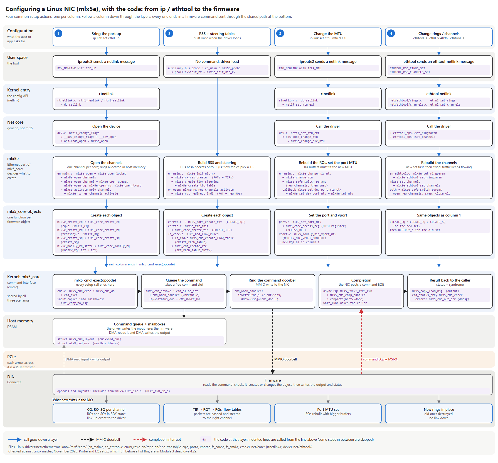

# Configuring a Linux NIC: from `ip` and `ethtool` to the firmware

Part of [Configuration flows](config-flows.md). It's the setup half of [A day in the life of a packet](packet-life.md).

This drawing shows four common setup actions on a kernel network interface (`mlx5e`), one per column. Each column goes down through the layers until it becomes firmware commands. The bottom part, how a firmware command travels, is shared by all three configuration drawings and is explained on [the overview page](config-flows.md#the-shared-part-how-one-firmware-command-travels).

**How to read it**

- **Columns** are the four actions, numbered 1 to 4.
- **Rows** are layers, from the user's tool at the top to the firmware at the bottom. A column skips a row it doesn't use (column 2 starts in the driver).
- The **purple block** in each box is the code that does that layer's work. Indented lines are called from the line above.
- The **blue boxes at the bottom** show what exists in the NIC after the column finishes.

*Click the image to open it full size.*

---

## The four columns in plain words

| # | Action | What happens | Firmware commands |
| --- | --- | --- | --- |
| **1** | `ip link set eth0 up` | `ip` sends a netlink message. The kernel's net core calls the driver's open function, `mlx5e_open`. The driver builds one **channel** per CPU core. For each channel it allocates the rings in host memory and asks the firmware to create a CQ, an RQ and an SQ. It then moves the RQs and SQs to the ready state and points RSS at the new RQs | `CREATE_CQ`, `CREATE_RQ`, `CREATE_SQ`, `MODIFY_RQ`, `MODIFY_SQ` |
| **2** | RSS and steering (at driver load) | When `mlx5e` loads, it builds the receive "switchboard". **RQTs** are tables of RQs. **TIRs** hash each packet's addresses and ports to pick an entry in an RQT. **Flow tables** decide which TIR a packet goes to, by MAC, VLAN or protocol. When channels open (column 1), the RQTs are redirected to the new RQs | `CREATE_RQT`, `CREATE_TIR`, `CREATE_FLOW_TABLE`, `SET_FLOW_TABLE_ENTRY` |
| **3** | `ip link set eth0 mtu 9000` | The driver must rebuild the RQs, because receive buffers have to fit the new MTU. It does this safely: it opens a new set of channels, swaps them in, and closes the old set. On the way it writes the new MTU into the port's **PMTU register** and the NIC's vport context | `ACCESS_REG` (PMTU), `MODIFY_NIC_VPORT_CONTEXT`, plus the column 1 commands |
| **4** | `ethtool -G` (ring size) or `ethtool -L` (number of channels) | The same "build new, swap, close old" method as column 3. Traffic keeps flowing and the link doesn't go down | Column 1's `CREATE_*` for the new set, then `DESTROY_*` for the old set |

**Before all of this:** when the driver first loads, `probe_one` sets up the command interface itself, the event queues and the MSI-X interrupts. See [Module 3 deep dive, 4.2a](module3-deep-dive.md#42a-probe_one-walked-step-by-step-where-dma-msi-x-and-rdma-get-configured).

---

## Watch it on a real machine

| What to see | Command |
| --- | --- |
| The firmware commands that `ip link set eth0 up` sends | Enable the `mlx5:mlx5_cmd` tracepoint (see [the overview](config-flows.md#watch-configuration-on-a-real-machine)), then run `ip link set eth0 down; ip link set eth0 up` |
| Channels and ring sizes | `ethtool -l eth0`, `ethtool -g eth0` |
| The RSS hash key and indirection table (the RQT) | `ethtool -x eth0` |
| MTU | `ip link show eth0` |

Files: Linux `drivers/net/ethernet/mellanox/mlx5/core/` (`en_main.c`, `en_ethtool.c`, `en/rx_res.c`, `en/rqt.c`, `en/tir.c`, `transobj.c`, `cq.c`, `port.c`, `vport.c`, `fs_core.c`, `fs_cmd.c`, `cmd.c`), `net/core/` (`rtnetlink.c`, `dev.c`) and `net/ethtool/`. The names were checked against Linux `master` in November 2026.

Editable source of the drawing: [images/config-linux-nic.svg](images/config-linux-nic.svg).
