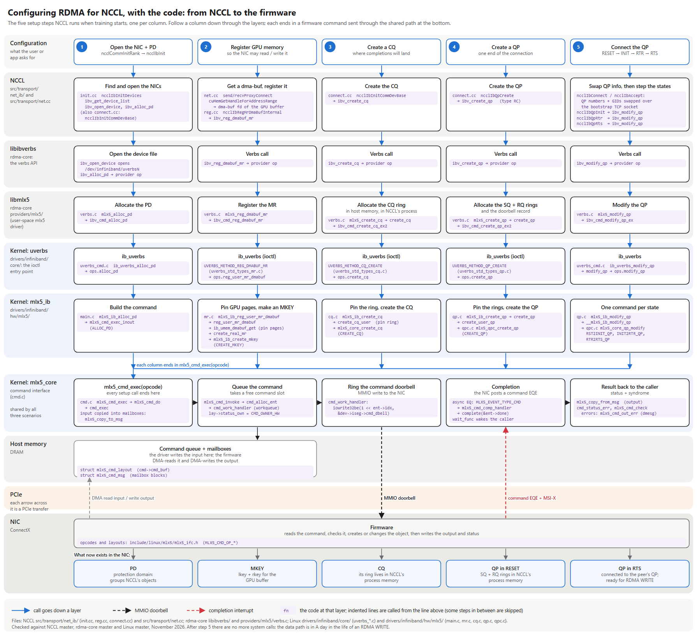

# Configuring RDMA for NCCL: from NCCL to the firmware

Part of [Configuration flows](config-flows.md). It's the setup half of [A day in the life of an RDMA WRITE](packet-rdma-nccl.md).

This drawing shows the five setup steps NCCL runs when training starts, one per column. Each column goes down through the layers: NCCL, the verbs API (libibverbs), the user-space mlx5 driver (`libmlx5`), the kernel's uverbs entry point, and `mlx5_ib`. It ends as a firmware command. The bottom part, how a firmware command travels, is shared by all three configuration drawings and is explained on [the overview page](config-flows.md#the-shared-part-how-one-firmware-command-travels).

**How to read it**

- **Columns** are the five setup steps, numbered 1 to 5, in the order NCCL runs them.
- **Rows** are layers, from NCCL at the top to the firmware at the bottom. Every column uses every row.
- The **purple block** in each box is the code that does that layer's work. Indented lines are called from the line above.
- The **blue boxes at the bottom** show what exists in the NIC after the column finishes.

*Click the image to open it full size.*

---

## The five columns in plain words

| # | Step | What happens | Firmware command |
| --- | --- | --- | --- |
| **1** | Open the NIC + PD | NCCL lists the RDMA devices and opens each NIC, which opens `/dev/infiniband/uverbsN`. It then allocates a **protection domain**: a container that groups NCCL's objects, so they can be used together and nobody else's can | `ALLOC_PD` |
| **2** | Register GPU memory | NCCL asks CUDA for a **dma-buf** handle to its GPU buffer (`cuMemGetHandleForAddressRange`) and registers it with `ibv_reg_dmabuf_mr`. The kernel pins the GPU pages through dma-buf, and the firmware creates an **MKEY**. The result is an **lkey** (for this NIC) and an **rkey** (which NCCL sends to the peer so its NIC may write here) | `CREATE_MKEY` |
| **3** | Create a CQ | `libmlx5` allocates the completion ring **in NCCL's own process memory**. The kernel pins it, and the firmware is told where it is | `CREATE_CQ` |
| **4** | Create a QP | `libmlx5` allocates the send and receive rings and the doorbell record, also in NCCL's memory. The firmware creates a reliable-connected (RC) QP, which starts in the **RESET** state | `CREATE_QP` |
| **5** | Connect the QP | The two sides swap QP numbers and addresses (GIDs) over NCCL's bootstrap TCP socket. Then each side moves its QP through **INIT** (port and access rights), **RTR** (ready to receive: the peer's QP number and address) and **RTS** (ready to send: timeouts and retry counts). Each move is one `ibv_modify_qp` and one firmware command | `RST2INIT_QP`, `INIT2RTR_QP`, `RTR2RTS_QP` |

**After step 5** there are no more system calls and no more firmware commands. Every RDMA WRITE is posted from user space, as shown in [A day in the life of an RDMA WRITE](packet-rdma-nccl.md).

---

## Watch it on a real machine

| What to see | Command |
| --- | --- |
| The same five steps in a tiny program | `ibv_rc_pingpong` (from rdma-core): run it on two hosts and trace it with `strace -e ioctl` |
| The firmware commands NCCL sends at start | Enable the `mlx5:mlx5_cmd` tracepoint (see [the overview](config-flows.md#watch-configuration-on-a-real-machine)), then start the job |
| PDs, MRs, CQs and QPs that exist now, and their owners | `rdma resource show pd`, `rdma resource show mr`, `rdma resource show cq`, `rdma resource show qp` |
| What NCCL chose and whether GPU memory registration worked | `NCCL_DEBUG=INFO` (look for `NET/IB` and `GDRDMA`) |

Files: NCCL `src/transport/net_ib/` (`init.cc`, `reg.cc`, `connect.cc`) and `src/transport/net.cc`; rdma-core `libibverbs/` and `providers/mlx5/verbs.c`; Linux `drivers/infiniband/core/` (`uverbs_cmd.c`, `uverbs_std_types_*.c`) and `drivers/infiniband/hw/mlx5/` (`main.c`, `mr.c`, `cq.c`, `qp.c`, `qpc.c`). The names were checked against NCCL `master`, rdma-core `master` and Linux `master` in November 2026.

Editable source of the drawing: [images/config-rdma-nccl.svg](images/config-rdma-nccl.svg).
