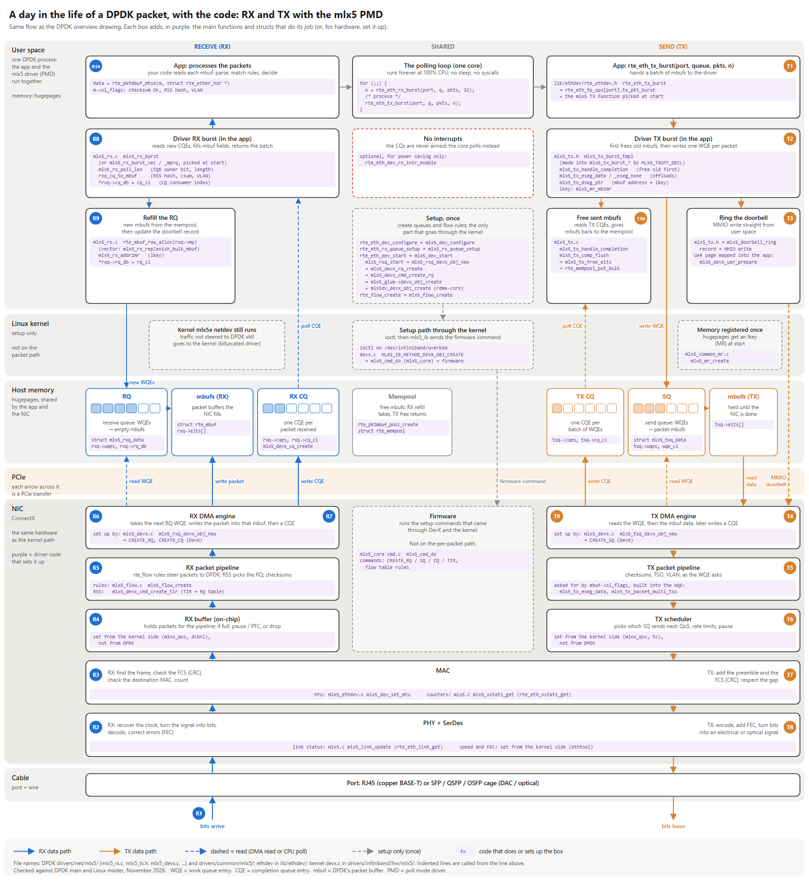

# A day in the life of a DPDK packet: find it in the code

This is the deep-dive companion to [A day in the life of a DPDK packet](packet-dpdk.md). Read that page first: it explains every step in plain words.

This drawing has the same boxes, arrows and step numbers (`R1` to `R10` for receive, `T1` to `T10` for send). In addition, each box lists, in purple, the main functions, structs and fields that do its job, so you can find each step in the source:

- **App and driver boxes** show the call chain. Indented lines are called from the line above (some steps in between are skipped).
- **Host memory boxes** show the struct and the fields that hold each ring.
- **NIC boxes** are hardware, so they show the code that **sets them up** (for example `mlx5_rxq_devx_obj_new`) or **asks for an offload** (for example `mlx5_tx_eseg_data`).

Where to look:

| Code | Tree | Path |
| --- | --- | --- |
| The mlx5 PMD (RX, TX, queues, flows) | [DPDK](https://github.com/DPDK/dpdk) | `drivers/net/mlx5/` (`mlx5_rx.c`, `mlx5_tx.h`, `mlx5_tx.c`, `mlx5_devx.c`, `mlx5_flow.c`, ...) |
| Code shared by the mlx5 drivers (DevX commands, memory registration, doorbells) | DPDK | `drivers/common/mlx5/` |
| `rte_eth_*` API | DPDK | `lib/ethdev/` |
| `mlx5dv_devx_obj_create` | [rdma-core](https://github.com/linux-rdma/rdma-core) | `providers/mlx5/` |
| DevX in the kernel | Linux | `drivers/infiniband/hw/mlx5/devx.c` |

The names were checked against DPDK `main`, rdma-core `master` and Linux `master` in November 2026. Older releases may differ slightly, so use `git grep <function>` to find each one in your tree.

*Click the image to open it full size.*

Editable source of the drawing: [images/packet-dpdk-detailed.svg](images/packet-dpdk-detailed.svg).
