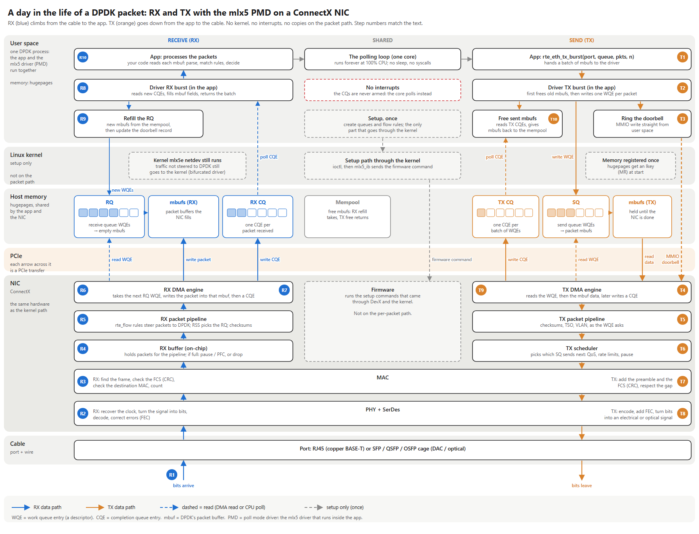

# A day in the life of a DPDK packet: RX and TX

This page follows one packet **in** (RX) and one packet **out** (TX) through a **DPDK** app, such as a firewall or a 5G packet core, running on an NVIDIA ConnectX NIC with the DPDK `mlx5` driver.

It is the companion to [A day in the life of a packet](packet-life.md), which shows the normal **kernel sockets** path. Read that page first. The hardware steps (cable, PHY, MAC, pipeline, DMA) are the same here. What changes is everything **above** the NIC: no kernel, no interrupts, no copies.

**How to read the drawing**

- **Bands (rows)** are places, from the app at the top to the cable at the bottom. The kernel band is grey because it is used **only for setup**.
- **Columns:** receive is on the left (blue), send is on the right (orange), and shared parts are in the middle.
- **Numbered circles** are steps. `R1` to `R10` are receive, `T1` to `T10` are send. The tables below explain each one.
- **Solid arrows** move packet data. **Dashed arrows** are reads: the NIC fetching a descriptor, or the app **polling** a completion queue. **Grey dashed arrows** happen once, at setup.

**Want to dive deeper?** [Find it in the code](packet-dpdk-code.md) has the same drawing with the main DPDK functions for every box.

---

## What is different from the kernel path

| | Kernel sockets ([packet-life.md](packet-life.md)) | DPDK (this page) |
| --- | --- | --- |
| Who drives the NIC | `mlx5e` in the kernel | The DPDK `mlx5` driver (a **PMD**, poll mode driver), running **inside the app's process** |
| How the app gets packets | `recv()` system call, data copied out of the kernel | `rte_eth_rx_burst()`: a normal function call, no system call, no copy |
| How the driver finds new packets | Interrupt, then NAPI | The app's core **polls** the completion queue in a loop, all the time |
| Packet memory | Kernel pages (page pool) | **Hugepages**, owned by the app, in a pool of **mbufs** |
| Doorbell | Written by the kernel | Written **directly from user space**: the NIC's doorbell page is mapped into the app |
| CPU cost | Shared with everything else on the core | One or more cores are **dedicated** and run at 100%, even when idle |

The trade: DPDK burns whole cores but gets tens of millions of packets per second per core, with very steady latency.

---

## The words you need

| Word | Meaning |
| --- | --- |
| **PMD** (poll mode driver) | A DPDK driver. The mlx5 PMD lives in `drivers/net/mlx5/` in the DPDK tree and is compiled into the app |
| **mbuf** | DPDK's packet buffer (`struct rte_mbuf`): some metadata plus room for one packet |
| **Mempool** | A pool of free mbufs, made at start with `rte_pktmbuf_pool_create`. RX takes from it, TX gives back to it |
| **Hugepages** | Large (2 MB or 1 GB) memory pages. They don't move and need few address translations, so the NIC can DMA into them safely and fast |
| **lcore** | A CPU core given to DPDK. Each one usually runs one polling loop |
| **WQE / CQE** | The same descriptors as in the kernel path: "here is a buffer" and "done" |

---

## Before the first packet: setup (step 0)

This is the **only** part that goes through the kernel and the firmware.

1. The app starts DPDK. DPDK reserves hugepages and creates the **mempool** of mbufs.
2. `rte_eth_dev_configure`, `rte_eth_rx_queue_setup`, `rte_eth_tx_queue_setup` and `rte_eth_dev_start` create the rings (RQ, SQ, CQs) **in the app's own hugepage memory**.
3. The PMD builds the firmware commands itself (**DevX**) and sends them through rdma-core (`mlx5dv_devx_obj_create`), an `ioctl` into the kernel's `mlx5_ib`, then `mlx5_core`, to the firmware: `CREATE_CQ`, `CREATE_RQ`, `CREATE_SQ`, `CREATE_TIR` (for RSS).
4. The mempool memory is **registered** with the NIC, so every mbuf address has a key (**lkey**) the NIC accepts.
5. The NIC's doorbell page (UAR) is **mapped into the app**, so the app can ring doorbells without a system call.
6. **Flow rules** (`rte_flow_create`) tell the NIC which traffic goes to DPDK. The mlx5 driver is **bifurcated**: the kernel's `mlx5e` network interface stays up. In isolated mode (`rte_flow_isolate`), traffic without a DPDK rule keeps going to the kernel, so `ssh` still works on the same port.
7. The PMD fills each RQ with empty mbufs.

After this, the kernel and the firmware are not touched again until the app stops.

---

## RX: a packet arrives

### On the cable and in the NIC (R1 to R7)

These steps are the same as in the kernel path ([R1 to R7 there](packet-life.md#rx-a-packet-arrives)), with one change in R5 and the end of R7.

| Step | Where | What happens |
| --- | --- | --- |
| **R1** | Cable and port | The signal arrives at the port (RJ45, or SFP/QSFP/OSFP on 25G and faster cards) |
| **R2** | PHY + SerDes | Recovers the clock, turns the signal into bits, corrects errors (FEC) |
| **R3** | MAC | Finds the frame, checks the FCS (CRC), checks the destination MAC, counts |
| **R4** | RX buffer (on-chip) | Holds the frame. If full: pause/PFC, or drop (`rx_discards_phy`) |
| **R5** | RX packet pipeline | Parses the headers. **The `rte_flow` rules the app created** decide that this packet belongs to DPDK. **RSS** picks one of the app's RQs. Checksums are checked and the VLAN tag is stripped |
| **R6** | RX DMA engine → hugepages | The NIC takes the next WQE from the RQ, which points to an empty mbuf, and writes the packet into it over PCIe. If the RQ is empty, the packet is dropped (`rx_out_of_buffer`): the app isn't polling fast enough |
| **R7** | RX DMA engine → RX CQ | The NIC writes a CQE: length, checksum OK, RSS hash, VLAN. **That is all.** The CQ is not armed, so there is **no event and no interrupt** |

### In the app (R8 to R10)

| Step | Where | What happens |
| --- | --- | --- |
| **R8** | Driver RX burst (in the app) | On its next loop, the app calls `rte_eth_rx_burst(port, queue, pkts, 32)`. The PMD (`mlx5_rx_burst`, or a vector version) reads the CQ in memory. For each new CQE (found by its ownership bit), it fills the mbuf's fields (length, RSS hash, checksum flags, VLAN) and adds it to the batch. It then updates the CQ's consumer index. This is an ordinary function call: no system call, no interrupt, no copy |
| **R9** | Refill | For each mbuf it handed to the app, the PMD takes a fresh one from the mempool, writes a new WQE into the RQ, and updates the RQ **doorbell record** (in memory; the NIC reads it, no MMIO needed) |
| **R10** | App | Gets an array of mbufs and processes them: firewall rules, NAT, forwarding. Often it then sends them right out again with `rte_eth_tx_burst` (T1) |

**The loop in one line:** the app's core spins on `rx_burst`, process, `tx_burst`, forever. When there is no traffic, `rx_burst` simply returns 0 and the core tries again.

---

## TX: the app sends a packet

### From the app to the doorbell (T1 to T3)

| Step | Where | What happens |
| --- | --- | --- |
| **T1** | App | `rte_eth_tx_burst(port, queue, pkts, n)`: hands a batch of mbufs to the PMD. A function call, not a system call |
| **T2** | Driver TX burst (in the app) | **First**, the PMD frees mbufs from earlier sends that the NIC has finished (see T10). Then, for each packet, it writes a WQE into the SQ: offload flags taken from `mbuf->ol_flags` (checksum, TSO, VLAN), and the mbuf's address plus its **lkey**. Small packets may be copied (inlined) into the WQE itself |
| **T3** | Doorbell | The PMD updates the doorbell record and writes the NIC's doorbell register, **straight from user space**, through the doorbell page mapped at setup. One doorbell per burst, not per packet |

### In the NIC and onto the cable (T4 to T8)

These are the same as the kernel path ([T5 to T9 there](packet-life.md#tx-the-app-sends-a-packet)).

| Step | Where | What happens |
| --- | --- | --- |
| **T4** | TX DMA engine | Reads the WQE, then reads the packet bytes from the mbuf in hugepages |
| **T5** | TX packet pipeline | Calculates checksums, TSO cuts large sends into MTU-size packets, inserts the VLAN tag |
| **T6** | TX scheduler | Picks which SQ sends next: QoS, rate limits, pause |
| **T7** | MAC | Adds the preamble and FCS |
| **T8** | PHY + SerDes | Encodes the bits and drives the signal onto the cable |

### Cleaning up (T9 and T10)

| Step | Where | What happens |
| --- | --- | --- |
| **T9** | TX DMA engine → TX CQ | The NIC writes a CQE. The PMD asks for one only every few WQEs. No interrupt |
| **T10** | Free sent mbufs | At the **start of the next `rte_eth_tx_burst`**, the PMD reads the new TX CQEs and returns the finished mbufs to the mempool. If the app stops calling `tx_burst`, old mbufs are not freed until it calls again |

---

## Where the CPU, the NIC and the kernel each work

| | App core (user space) | NIC by itself | Kernel | Firmware |
| --- | --- | --- | --- | --- |
| **Setup** | Calls `rte_eth_*`, `rte_flow_*` | none | `ioctl` → `mlx5_ib` → `mlx5_core` | Runs `CREATE_*` commands |
| **RX** | Polls the CQ, fills mbufs, refills the RQ, processes | PHY, MAC, steering, RSS, checksum, DMA, CQE | none | none |
| **TX** | Writes WQEs, rings the doorbell, frees mbufs | DMA, checksum, TSO, scheduling, MAC, PHY, CQE | none | none |

---

## Watch it on a real machine

| What to see | Command |
| --- | --- |
| Run a ready-made DPDK app on the port | `dpdk-testpmd -a <pci-address> -- -i`, then `start` |
| Port and queue counters | In testpmd: `show port stats all`, `show port xstats 0` |
| The dedicated cores at 100% | `top` (press `1` for per-core view): the DPDK cores stay busy even with no traffic |
| Hugepages in use | `grep Huge /proc/meminfo` |
| Flow rules DPDK installed | In testpmd: `flow list 0` |

| Counter (`xstats`) | Step | Meaning |
| --- | --- | --- |
| `rx_crc_errors_phy` | R3 | Bad frames on the wire |
| `rx_discards_phy` | R4 | The NIC's buffer overflowed |
| `rx_out_of_buffer` | R6 | No free RQ WQE: the app isn't calling `rx_burst` fast enough, or the mempool is empty |

---

## See also

- [A day in the life of a packet](packet-life.md): the kernel sockets path, step by step.
- [A day in the life of an RDMA WRITE](packet-rdma-nccl.md): NCCL moving GPU data between servers.
- [Module 3 deep dive, 3.2 Door 2: DPDK](module3-deep-dive.md#32-door-2-dpdk-example-a-firewall), and [4.1](module3-deep-dive.md#41-one-call-traced-line-by-line-dpdk-creates-a-send-queue), where one DPDK setup call is traced line by line.

Editable source of the drawing: [images/packet-dpdk.svg](images/packet-dpdk.svg).
