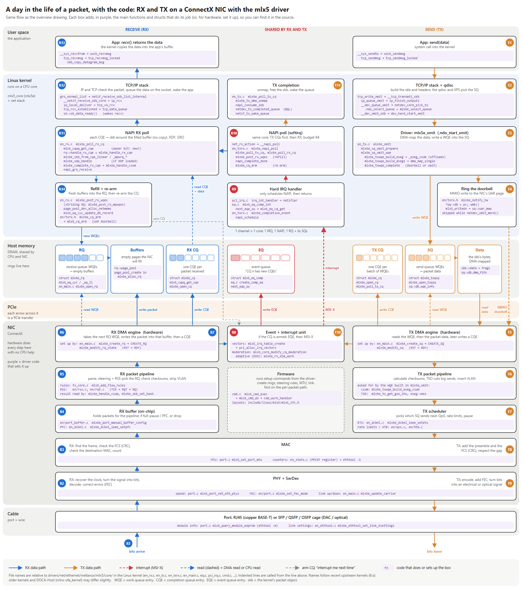

# A day in the life of a packet: find it in the code

This is the deep-dive companion to [A day in the life of a packet](packet-life.md). Read that page first: it explains every step in plain words.

This drawing has the same boxes, arrows and step numbers (`R1` to `R14` for receive, `T1` to `T11` for send). In addition, each box lists, in purple, the main functions and structs that do its job, so you can find each step in the source:

- **Kernel boxes** show the call chain. Indented lines are called from the line above.
- **Host memory boxes** show the struct that holds the ring and where it is created.
- **NIC boxes** are hardware, so they show the driver code that **sets them up** (for example `mlx5e_create_rq`) or **reads their result** (for example `mlx5e_handle_csum`).

File names are relative to `drivers/net/ethernet/mellanox/mlx5/core/` in the Linux kernel. The names were checked against upstream Linux `master` in November 2026. Older kernels and DOCA-Host (`mlnx-ofa_kernel`) may differ slightly, so use `git grep <function>` to find each one in your tree.

*Click the image to open it full size.*

Editable source of the drawing: [images/packet-rx-tx-detailed.svg](images/packet-rx-tx-detailed.svg).
