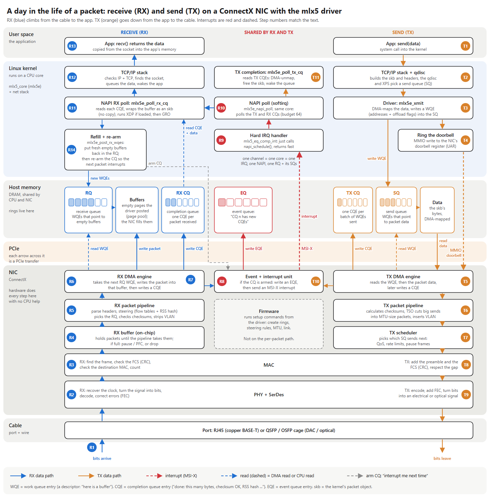

# A day in the life of a packet: RX and TX

This page follows one packet **in** (RX, receive) and one packet **out** (TX, send) through a server with an NVIDIA ConnectX NIC and the Linux `mlx5` driver. RX starts at the cable and ends in the app. TX starts in the app and ends on the cable.

This is the **kernel sockets** path (door 1 in the [Module 3 deep dive](module3-deep-dive.md#part-1-use-cases-what-customers-do-with-the-nic)). DPDK and RDMA reuse the same hardware steps, but they replace the interrupt and kernel parts with polling from user space. See [the differences](#how-dpdk-and-rdma-differ) at the end.

**How to read the drawing**

- **Bands (rows)** are places, from the app at the top to the cable at the bottom: user space, kernel (CPU), host memory, the PCIe bus, the NIC, the cable.
- **Columns** split the work: receive on the left (blue), send on the right (orange), and the parts both share in the middle (red).
- **Numbered circles** are steps. `R1` to `R14` are receive, `T1` to `T11` are send. The tables below explain each one.
- **Solid arrows** move packet data. **Dashed arrows** are reads (the NIC or the CPU fetching something). The **red dashed arrow** is the interrupt.

**Want to dive deeper?** [Find it in the code](packet-life-code.md) has the same drawing with the main kernel functions for every box. **How the queues get created in the first place:** [Configuring a Linux NIC](config-linux-nic.md).

---

## The five words you need

| Word | Meaning |
| --- | --- |
| **Ring (queue)** | A circular array in host memory that the driver and the NIC share. The driver adds entries at one end and the NIC takes them from the other |
| **WQE** ("wookie", work queue entry) | A small descriptor the driver writes into a ring: "here is a buffer to fill" (RX) or "here is a packet to send" (TX). It holds memory addresses, not the packet itself |
| **CQE** (completion queue entry) | The NIC's answer: "done". For RX it also says how long the packet is, whether the checksum was good, the RSS hash, and the VLAN |
| **EQE** (event queue entry) | A one-line note from the NIC: "completion queue number N has new CQEs" |
| **Doorbell** | A write by the driver to a NIC register over PCIe that says "there is new work" or "interrupt me next time" |

The queues come in groups called **channels**. One channel per CPU core, usually. Each channel has one RQ (receive queue), one or more SQs (send queues), a CQ for each of them, and one interrupt vector. That is how the NIC spreads load over all cores, and why one core handles both the RX and TX completions of its channel.

---

## Before the first packet: setup (step 0)

Nothing in the steps below works until the driver has prepared the rings. This happens once, when the port comes up (`ip link set eth0 up`):

1. The driver allocates the rings (RQ, SQ, CQ, EQ) in host memory.
2. It sends **firmware commands** (`CREATE_EQ`, `CREATE_CQ`, `CREATE_RQ`, `CREATE_SQ`, steering rules) so the NIC knows where the rings are.
3. It fills every RQ with **empty buffers** (pages from the page pool), one WQE per buffer.
4. It **arms** each CQ: "when a CQE lands here, interrupt me".

After this, firmware is **not** on the per-packet path. That's why the drawing shows it greyed out.

---

## RX: a packet arrives

### On the cable and in the NIC (R1 to R5)

| Step | Where | What happens |
| --- | --- | --- |
| **R1** | Cable and port | The signal arrives at the port. On copper 1G/10GBASE-T this is an **RJ45** socket. On 25G and faster ConnectX cards it is an SFP/QSFP/OSFP cage with a direct-attach copper (DAC) cable or an optical module. The rest of the flow is the same |
| **R2** | PHY + SerDes | The PHY recovers the clock from the signal, turns it into bits, decodes the line code, and corrects bit errors with **FEC** (forward error correction) |
| **R3** | MAC | The MAC finds where the frame starts and ends, and checks the **FCS** (a CRC at the end of every Ethernet frame). A bad CRC means the frame is dropped and counted (`rx_crc_errors_phy`). It also checks the destination MAC address and updates the port counters |
| **R4** | RX buffer (on-chip) | The frame waits in a small memory inside the NIC. If this buffer fills up, the NIC either sends **pause / PFC** frames to the switch ("stop sending for a moment") or drops the packet (`rx_discards_phy`) |
| **R5** | RX packet pipeline | Hardware parses the headers (Ethernet, VLAN, IP, TCP/UDP, tunnels). **Steering** (flow tables the driver set up) decides where the packet goes. **RSS** hashes the IP addresses and ports to pick one RQ, so one flow always lands on the same CPU core. The pipeline also checks the IP/TCP checksums, strips the VLAN tag and timestamps the packet |

### Across PCIe into host memory (R6 and R7)

| Step | Where | What happens |
| --- | --- | --- |
| **R6** | RX DMA engine → host memory | The NIC takes the next WQE from the chosen RQ. It has usually fetched it ahead of time. The WQE gives the address of an empty buffer. The NIC writes the packet into that buffer with **DMA**: a series of PCIe memory writes. The CPU does nothing. If the RQ has no free WQE, the packet is dropped (`rx_out_of_buffer`). That usually means the driver can't keep up |
| **R7** | RX DMA engine → RX CQ | The NIC writes a **CQE** into the RX completion queue: length, checksum OK, RSS hash, VLAN, flow tag. It sets the CQE's **ownership bit**, so the driver can tell new CQEs from old ones |

### The interrupt (R8 and R9)

| Step | Where | What happens |
| --- | --- | --- |
| **R8** | Event + interrupt unit | If the CQ is **armed**, the NIC writes an **EQE** into the event queue ("CQ n has new CQEs"). Then it sends an **MSI-X interrupt**. An MSI-X interrupt is just one more PCIe memory write, to an address owned by the CPU's interrupt controller. The IRQ affinity setting decides which core receives it. The CQ then disarms itself, so the NIC raises **no more interrupts** until the driver re-arms it. If the CQ is not armed, the CQE is written and no interrupt is sent |
| **R9** | CPU: hard IRQ handler | The core stops what it was doing and runs the handler: `irq_int_handler` (in `pci_irq.c`), which calls the EQ's notifier, `mlx5_eq_comp_int`, which reads the EQE and calls `mlx5e_completion_event`. That calls `napi_schedule()`. The handler does **no packet work**. It returns within a few microseconds and leaves the real work to a softirq |

**Why so little work in the interrupt?** An interrupt per packet would kill the CPU at millions of packets per second. So Linux uses **NAPI**: one interrupt wakes a poll loop, and the poll loop then handles many packets **with interrupts off**. The NIC also delays the interrupt a little to batch more packets (**interrupt moderation**, set with `ethtool -C`, and tuned automatically by **DIM**). That trades a few microseconds of latency for much less CPU load.

### In the kernel and up to the app (R10 to R14)

| Step | Where | What happens |
| --- | --- | --- |
| **R10** | NAPI poll (softirq, same core) | `mlx5e_napi_poll` runs. It polls this channel's TX CQs first (step T11), then the RX CQ, up to a **budget** of 64 packets per round |
| **R11** | `mlx5e_poll_rx_cq` | For each new CQE, the driver wraps the buffer the NIC filled as an **skb** (the kernel's packet object). It does not copy the data. If an **XDP** program is loaded, it runs here first and can drop, redirect or pass the packet. Then **GRO** merges packets of the same TCP flow into one bigger skb, so the stack has less to do |
| **R12** | TCP/IP stack | IP and TCP check the packet, find the socket it belongs to, put the data on the socket's receive queue, and wake the app |
| **R13** | App | `recv()` returns. The kernel copies the data from the skb into the app's memory |
| **R14** | Refill and re-arm | `mlx5e_post_rx_wqes` puts fresh empty buffers back into the RQ. It writes the new WQEs and updates a **doorbell record** in host memory, which the NIC reads; no PCIe register write is needed. When the poll loop has finished all the work (fewer than 64 packets), it calls `napi_complete_done` and **re-arms the CQ** with `mlx5e_cq_arm`. That is a doorbell write to the NIC: "interrupt me for the next packet". The cycle is back at step R1 |

**The loop in one line:** the NIC fills buffers the driver gave it. The driver takes the full ones and gives back empty ones. The interrupt only says "come and look".

---

## TX: the app sends a packet

### From the app to the doorbell (T1 to T4)

| Step | Where | What happens |
| --- | --- | --- |
| **T1** | App | `send(socket, data)`: a system call into the kernel |
| **T2** | TCP/IP stack + qdisc | TCP copies the data into an skb and builds TCP and IP headers. With **TSO** (TCP segmentation offload) it builds one large skb, up to 64 KB, and lets the NIC cut it later. The packet passes the **qdisc** (the queueing layer). **XPS** picks the SQ that belongs to the current core |
| **T3** | Driver: `mlx5e_xmit` | The driver **DMA-maps** the skb's data, which gives the NIC an address it may read through the IOMMU. It then writes a **WQE** into the SQ: a control segment, an Ethernet segment (the first header bytes, plus flags for "calculate the checksum" and "do TSO with this MSS"), and data segments that point to the packet bytes |
| **T4** | Doorbell | The driver updates the doorbell record, then writes to the NIC's **doorbell register** (in the UAR page) over PCIe: "SQ n has new WQEs up to here". This is the one CPU-to-NIC register write per batch. When the stack has more packets coming (`xmit_more`), the driver writes several WQEs and rings the doorbell once |

### In the NIC and onto the cable (T5 to T9)

| Step | Where | What happens |
| --- | --- | --- |
| **T5** | TX DMA engine | The NIC **reads the WQE** from the SQ, then **reads the packet bytes** it points to. Both are PCIe reads from host memory |
| **T6** | TX packet pipeline | Offloads: the NIC calculates the IP/TCP/UDP checksums, **TSO** cuts a large send into MTU-size packets with correct headers, it inserts the VLAN tag, and it can encrypt (IPsec, TLS, MACsec). Steering and the eswitch also apply here (for example, for VFs) |
| **T7** | TX scheduler | Picks which SQ sends next, following QoS settings and rate limits. It stops sending to the port while the switch has paused it |
| **T8** | MAC | Adds the preamble and the FCS (CRC), and keeps the minimum gap between frames |
| **T9** | PHY + SerDes | Encodes the bits, adds FEC, and turns them into an electrical or optical signal on the cable |

### Cleaning up (T10 and T11)

| Step | Where | What happens |
| --- | --- | --- |
| **T10** | NIC → TX CQ, EQ, interrupt | The NIC writes a **CQE** into the TX completion queue. To save PCIe traffic, the driver asks for a CQE only on some WQEs, so one CQE can cover a batch. Then comes the same path as R8: EQE, MSI-X interrupt, hard IRQ, `napi_schedule` |
| **T11** | NAPI: `mlx5e_poll_tx_cq` | The same NAPI poll as R10 reads the TX CQEs. For each sent packet it DMA-unmaps the buffer and frees the skb. It also updates **BQL** (byte queue limits, which keeps the queue short to lower latency). If the SQ was full and the stack had stopped it, the driver wakes it |

Until T11 runs, the packet's memory can't be reused. If completions are slow, the SQ fills up, the queue stops (`tx_queue_stopped`), and the app sees back-pressure.

---

## Where the CPU, the NIC and the bus each work

| | CPU does | NIC does by itself | Crosses PCIe |
| --- | --- | --- | --- |
| **RX** | IRQ handler, NAPI, building the skb, TCP/IP, copy to the app, refill | PHY, MAC, buffer, parse, steer, RSS, checksum, DMA, CQE, EQE | Packet write, CQE write, EQE write, MSI-X, WQE read, CQ arm doorbell |
| **TX** | TCP/IP, qdisc, WQE, doorbell, free the skb | DMA read, checksum, TSO, scheduling, MAC, PHY, CQE | Doorbell write, WQE read, packet read, CQE write, EQE write, MSI-X |

The theme of the whole driver: **the CPU never copies packet bytes to or from the NIC.** It only writes small descriptors and doorbells. The NIC's DMA engines move the data.

---

## Watch it on a real machine

| What to see | Command |
| --- | --- |
| The interrupt vectors, one per channel, and which cores get them | `grep mlx5 /proc/interrupts` |
| How many channels (queue sets) there are | `ethtool -l eth0` |
| Ring sizes (number of WQEs per RQ / SQ) | `ethtool -g eth0` |
| Interrupt moderation (R8) | `ethtool -c eth0` |
| Offloads: checksum, TSO, GRO, VLAN | `ethtool -k eth0` |
| Per-step drop and error counters | `ethtool -S eth0 \| grep -E 'crc\|discard\|out_of_buffer\|csum\|stopped\|wake'` |
| Link speed, FEC, signal quality (R2, T9) | `ethtool eth0`, `mlxlink -d <pci-address>` |

| Counter | Step | Meaning |
| --- | --- | --- |
| `rx_crc_errors_phy` | R3 | Bad frames on the wire: check the cable, the module or the switch port |
| `rx_discards_phy` | R4 | The NIC's own buffer overflowed: traffic is too bursty, or pause/PFC is off |
| `rx_out_of_buffer` | R6 | No free RQ WQE: the driver or CPU isn't refilling fast enough |
| `rx_csum_unnecessary` | R5 | The NIC checked the checksum, so the CPU didn't have to |
| `tx_queue_stopped` / `tx_queue_wake` | T11 | The SQ filled up and was paused, then resumed |

---

## How DPDK and RDMA differ

The hardware part (R1 to R7, T5 to T10 without the interrupt) is **the same** for every door. The difference is who does the CPU part:

| | Kernel sockets (this page) | DPDK | RDMA verbs |
| --- | --- | --- | --- |
| Who writes WQEs and rings doorbells | `mlx5e` in the kernel | The DPDK mlx5 driver, in the app's process | `libmlx5`, in the app's process |
| How completions are found | Interrupt → NAPI | The app **polls** the CQ in a busy loop. CQs are not armed, so there's no interrupt | Polling (`ibv_poll_cq`), or optionally an interrupt through a completion channel |
| Kernel on the packet path | Yes | No | No |
| Data copied by the CPU | Yes, into the app at `recv()` | No | No: the NIC writes straight into app (or GPU) memory |

Each of these has its own page, drawn the same way:

- [A day in the life of a DPDK packet](packet-dpdk.md): the app polls the NIC from user space.
- [A day in the life of an RDMA WRITE](packet-rdma-nccl.md): NCCL moves GPU data between two servers.

For the code-level version of these flows (file names and functions), see [Module 3 deep dive, 4.3 Send and receive in detail](module3-deep-dive.md#43-send-and-receive-in-detail).

Editable source of the drawing: [images/packet-rx-tx.svg](images/packet-rx-tx.svg).
