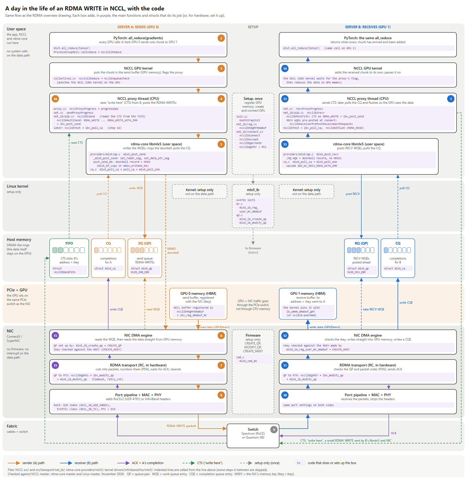

# A day in the life of an RDMA WRITE: find it in the code

This is the deep-dive companion to [A day in the life of an RDMA WRITE](packet-rdma-nccl.md). Read that page first: it explains every step in plain words.

This drawing has the same boxes, arrows and step numbers (1 to 16). In addition, each box lists, in purple, the main functions and structs that do its job, so you can find each step in the source:

- **Software boxes** (PyTorch, NCCL, rdma-core) show the call chain. Indented lines are called from the line above (some steps in between are skipped).
- **Host memory and GPU boxes** show the struct that holds each ring or buffer and where it is registered.
- **NIC boxes** are hardware, so they show the code that **sets them up** (for example `mlx5_ib_create_qp`, `mlx5_ib_modify_qp`) or the **key the hardware checks** (the MKEY behind the lkey and rkey).

Where to look:

| Code | Tree | Path |
| --- | --- | --- |
| `ProcessGroupNCCL::allreduce` | [PyTorch](https://github.com/pytorch/pytorch) | `torch/csrc/distributed/c10d/ProcessGroupNCCL.cpp` |
| NCCL collectives, proxy thread | [NCCL](https://github.com/NVIDIA/nccl) | `src/collectives.cc`, `src/proxy.cc`, `src/transport/net.cc`, `src/init.cc` |
| NCCL's RDMA (IB) transport | NCCL | `src/transport/net_ib/` (`p2p.cc` for send, receive and test, `connect.cc` for QPs, `reg.cc` for memory registration) |
| `libmlx5`: post send/recv, poll CQ | [rdma-core](https://github.com/linux-rdma/rdma-core) | `providers/mlx5/qp.c`, `providers/mlx5/cq.c` |
| `mlx5_ib`: QPs, MRs, dma-buf | Linux | `drivers/infiniband/hw/mlx5/` (`qp.c`, `mr.c`), `drivers/infiniband/core/umem_dmabuf.c` |

The names were checked against NCCL `master`, rdma-core `master`, PyTorch `main` and Linux `master` in November 2026. NCCL moves code between files often (the IB transport was split into `net_ib/` recently), so if a name isn't where the drawing says, use `git grep <function>`.

*Click the image to open it full size.*

Editable source of the drawing: [images/packet-rdma-nccl-detailed.svg](images/packet-rdma-nccl-detailed.svg).
