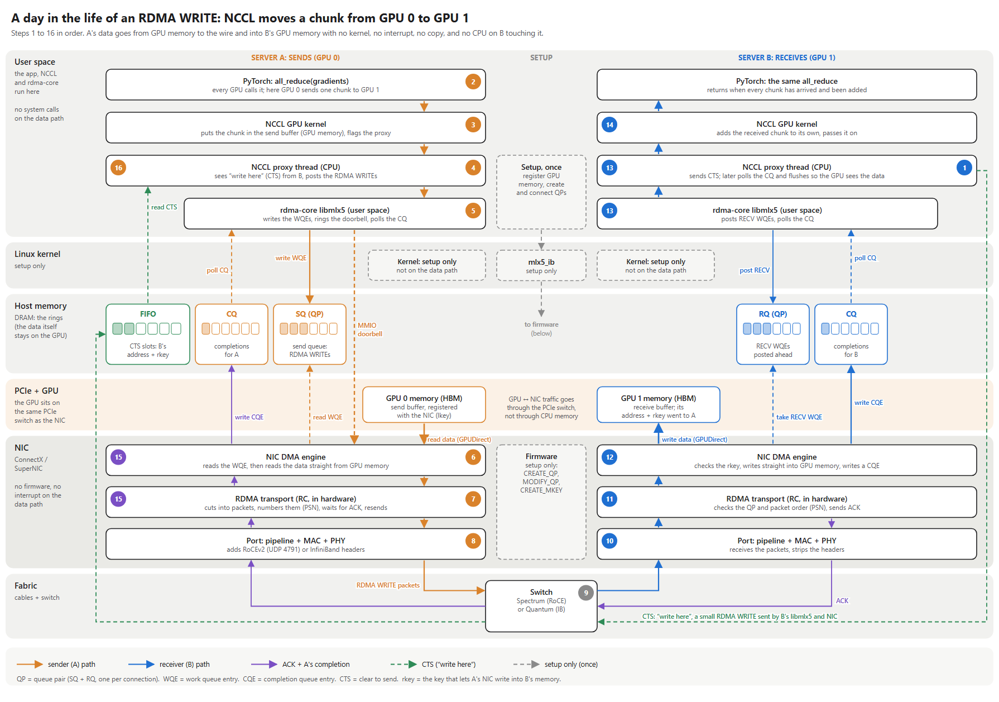

# A day in the life of an RDMA WRITE: NCCL moves GPU data between servers

This page follows one chunk of AI training data from **GPU 0 in server A** to **GPU 1 in server B**. It's an **RDMA WRITE**, posted by **NCCL** during a PyTorch `all_reduce`, over ConnectX NICs with the `mlx5` drivers.

It's the companion to [A day in the life of a packet](packet-life.md) (the kernel sockets path) and [the DPDK version](packet-dpdk.md). The NIC hardware is the same. What is new here:

- **Two servers.** The work is split between a sender and a receiver, and the receiver's CPU never touches the data.
- **GPU memory.** The NIC reads and writes GPU memory directly (**GPUDirect RDMA**).
- **A transport in hardware.** The NIC itself numbers the packets, waits for ACKs and resends lost packets, like TCP but with no software.

**How to read the drawing**

- **Left column:** server A, the sender (orange). **Right column:** server B, the receiver (blue). **Middle:** setup, which happens once, and the switch.
- **Bands (rows)** are places, from PyTorch at the top to the cables and switch at the bottom. The kernel band is grey: **setup only**.
- **Numbered circles** are the steps, **1 to 16, in time order**. Step 1 is on the receiver: B tells A where to write before A sends anything.
- **Arrow colours:** orange = A's data going out, blue = data arriving at B, purple = the ACK and A's completion, green dashed = the "clear to send" message (CTS), grey dashed = setup.

**Want to dive deeper?** [Find it in the code](packet-rdma-nccl-code.md) has the same drawing with the main NCCL, rdma-core and kernel functions for every box.

---

## The words you need

| Word | Meaning |
| --- | --- |
| **QP** (queue pair) | One end of an RDMA connection: a send queue (SQ) plus a receive queue (RQ). Like a socket. NCCL opens several per peer |
| **RC** (reliable connected) | The QP type NCCL uses. The NIC guarantees in-order, lossless delivery: it numbers every packet (**PSN**), waits for ACKs and resends on loss |
| **RDMA WRITE** | "Put these bytes at this address in your memory." The receiving NIC does it alone: no receiver CPU, no receiver software |
| **WRITE WITH IMMEDIATE** | An RDMA WRITE that also carries a 32-bit number and **creates a completion on the receiver**, so B knows the data has arrived |
| **MR / MKEY, lkey / rkey** | Memory must be **registered** before the NIC may touch it. Registration gives a local key (lkey, used by your own NIC) and a remote key (**rkey**, which you give to the peer so its NIC may write into your memory) |
| **GPUDirect RDMA** | The NIC reads and writes **GPU memory** directly over PCIe, without copying through CPU memory. GPU memory is registered through **dma-buf** (upstream) or the older **nvidia-peermem** module |
| **CTS** (clear to send) | NCCL's small message from receiver to sender: "your next chunk goes to this address, with this rkey". It is itself a tiny RDMA WRITE |
| **Proxy thread** | A CPU thread inside NCCL that posts the RDMA work and polls for completions on behalf of the GPU |
| **RoCE / InfiniBand** | The two networks RDMA runs on. RoCEv2 puts RDMA inside UDP packets (port 4791) on Ethernet. InfiniBand is its own network type |

---

## Before the first chunk: setup (step 0)

This happens once, when training starts (`ncclCommInitRank`). It is the only part that uses the kernel and the firmware.

1. **Bootstrap:** the NCCL ranks find each other over a normal TCP socket.
2. **Register GPU memory:** NCCL calls `ibv_reg_dmabuf_mr` on its GPU buffers. The kernel's `mlx5_ib` pins the GPU pages through dma-buf, and the firmware creates an **MKEY** (`CREATE_MKEY`). Result: an lkey and an rkey.
3. **Create the QPs and CQs:** `ibv_create_cq`, `ibv_create_qp`, then firmware `CREATE_CQ`, `CREATE_QP`. The rings live in normal host memory, mapped into NCCL's process.
4. **Connect:** the two sides swap QP numbers and addresses over the bootstrap socket, then move their QPs through the states INIT → RTR (ready to receive) → RTS (ready to send) with `ibv_modify_qp` (firmware `MODIFY_QP`). Timeout and retry counts are set here.
5. **Post receives ahead:** B posts RECV WQEs on its RQ, so each WRITE WITH IMMEDIATE has a slot to complete into.

After this, every chunk follows steps 1 to 16 with **no system call, no firmware command and no interrupt** on either server.

---

## The flow, step by step

### B gets ready, A prepares (1 to 3)

| Step | Where | What happens |
| --- | --- | --- |
| **1** | B: NCCL proxy thread | B's proxy has a free receive buffer in GPU 1's memory. It sends A a **CTS**: "write your next chunk here", with the address, size and rkey. The CTS is a small RDMA WRITE that lands in a **FIFO** in A's host memory (green dashed line) |
| **2** | A: PyTorch | The training step calls `all_reduce` on the gradients. PyTorch's NCCL backend calls `ncclAllReduce` |
| **3** | A: NCCL GPU kernel | NCCL's CUDA kernel runs on GPU 0. It cuts the data into chunks, puts the next chunk in NCCL's **send buffer** in GPU memory, and raises a flag for the proxy thread |

### A sends (4 to 8)

| Step | Where | What happens |
| --- | --- | --- |
| **4** | A: NCCL proxy thread | The proxy sees two things: data ready (from the GPU) and a CTS in the FIFO (from B). It builds a list of **RDMA WRITE** requests that cover the chunk. The last one is a **WRITE WITH IMMEDIATE**. Then it calls `ibv_post_send` |
| **5** | A: rdma-core `libmlx5` | Still in user space. `libmlx5` writes one WQE per request into the SQ: B's address and rkey, plus the local GPU address and lkey. It then rings the **doorbell** with an MMIO write straight from user space. No system call |
| **6** | A: NIC DMA engine | The NIC reads the WQE from host memory, then reads the chunk **directly from GPU 0's memory** over PCIe (**GPUDirect RDMA**). Ideally the GPU and the NIC sit under the same PCIe switch, so the data never crosses the CPU |
| **7** | A: RDMA transport (RC) | The NIC cuts the data into MTU-size packets and gives each one a sequence number (**PSN**). It keeps track of them until B acknowledges. If an ACK doesn't come in time, it resends, entirely in hardware |
| **8** | A: port | Adds the RoCEv2 headers (Ethernet + IP + UDP port 4791 + RDMA header) or InfiniBand headers, then MAC, PHY and the cable |

### Through the network (9)

| Step | Where | What happens |
| --- | --- | --- |
| **9** | Switch | A Spectrum (RoCE) or Quantum (InfiniBand) switch forwards the packets. RoCE needs a nearly lossless network: **PFC** pauses senders when buffers fill, and **ECN + DCQCN** slow them down early. InfiniBand uses credits, so the switch never drops |

### B receives (10 to 14)

| Step | Where | What happens |
| --- | --- | --- |
| **10** | B: port | Receives the packets and strips the headers |
| **11** | B: RDMA transport (RC) | Finds the QP, checks the packets arrive in order (PSN), and sends an **ACK** back to A (purple). A missing packet triggers a NAK and A resends |
| **12** | B: NIC DMA engine | Checks the **rkey**: is A allowed to write to this address range? Then it writes the data **straight into GPU 1's memory**. For the final WRITE WITH IMMEDIATE, it consumes one of the pre-posted RECV WQEs and writes a **CQE** into B's CQ. B's CPU and kernel have done nothing so far |
| **13** | B: proxy + `libmlx5` | B's proxy polls its CQ (`ibv_poll_cq`, which is just a memory read in `libmlx5`) and finds the CQE: "the chunk has arrived". If needed, it issues a small RDMA READ (**flush**) so the GPU is sure to see all the data |
| **14** | B: NCCL GPU kernel | GPU 1's NCCL kernel sees the flag, adds the chunk to its own data, and passes the result on to the next GPU in the ring. When every chunk is done, `all_reduce` returns on B |

### A finishes (15 and 16)

| Step | Where | What happens |
| --- | --- | --- |
| **15** | A: NIC | The ACK from step 11 arrives. A's NIC retires the WQEs and writes a **CQE** into A's CQ |
| **16** | A: NCCL proxy thread | A's proxy polls its CQ, sees the CQE, and marks the send buffer slot free for the next chunk |

**The point of RDMA in one line:** the data went from GPU 0's memory to GPU 1's memory through two NICs and a switch, and no kernel, no interrupt, no firmware command and no copy was involved. On B, no CPU instruction touched it.

---

## Who does what

| | Server A CPU | Server B CPU | NICs | Kernel | Firmware |
| --- | --- | --- | --- | --- | --- |
| **Setup** | NCCL + `libmlx5`: register memory, create and connect QPs | Same | none | `mlx5_ib` (ioctl) | `CREATE_MKEY`, `CREATE_QP`, `MODIFY_QP` |
| **Per chunk** | Proxy: post the WQEs, ring the doorbell, poll the CQ | Proxy: send the CTS, poll the CQ, flush | Everything else: DMA from and to GPU memory, transport, ACK, resend, rkey check | none | none |

A newer NCCL option removes even the proxy thread: with **GPU-initiated networking**, built on **DOCA GPUNetIO**, the GPU kernel writes the WQEs and rings the doorbell itself. See [Module 3 deep dive, 3.5](module3-deep-dive.md#35-nccl-the-biggest-rdma-customer).

---

## Watch it on a real machine

| What to see | Command |
| --- | --- |
| Which NIC and transport NCCL chose, and whether GPUDirect is on | `NCCL_DEBUG=INFO` when running the job. Look for `NET/IB` and `GDRDMA` |
| The standard benchmark | `all_reduce_perf -b 8 -e 4G -f 2 -g 1` from [nccl-tests](https://github.com/NVIDIA/nccl-tests), run on several servers with MPI |
| RDMA devices, ports and link state | `ibv_devinfo`, `rdma link` |
| The PCIe path between GPU and NIC (same switch is best) | `nvidia-smi topo -m`: `PIX` or `PXB` is good, `SYS` means it goes through the CPU |
| RDMA hardware counters | `ls /sys/class/infiniband/mlx5_0/ports/1/hw_counters/` |

| Counter (`hw_counters`) | Step | Meaning |
| --- | --- | --- |
| `out_of_sequence`, `packet_seq_err` | 11 | Packets arrived out of order or were lost: the network is dropping |
| `local_ack_timeout_err` | 7 | A sent and no ACK came in time, so it had to resend. Many of these lead to `transport retry counter exceeded` |
| `rnr_nak_retry_err` | 12 | B had no RECV WQE ready (receiver not ready) |
| `np_ecn_marked_roce_packets`, `np_cnp_sent`, `rp_cnp_handled` | 9 | RoCE congestion control at work (ECN / DCQCN) |

---

## See also

- [A day in the life of a packet](packet-life.md): the kernel sockets path.
- [A day in the life of a DPDK packet](packet-dpdk.md): user-space polling without RDMA.
- [Module 3 deep dive, 3.3 Door 3: RDMA verbs](module3-deep-dive.md#33-door-3-rdma-verbs-example-two-gpu-servers-training-a-model) and [3.5 NCCL](module3-deep-dive.md#35-nccl-the-biggest-rdma-customer).

Editable source of the drawing: [images/packet-rdma-nccl.svg](images/packet-rdma-nccl.svg).
